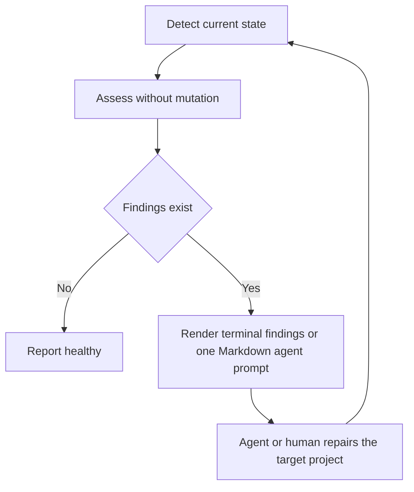

# Architecture

Adamantite is a preset package and CLI that applies and maintains code-quality tooling in
a target project. Product behavior is documented in the [README](../README.md), domain
terms live in [GLOSSARY.md](../GLOSSARY.md), and durable tradeoffs belong in
[decision records](./adr/README.md).

## Runtime

`src/index.ts` starts the Effect runtime. `src/cli.ts` defines the command tree and command
options. Command modules validate command-specific input, obtain Effect services, and
invoke target-project operations.

`@effect/platform-node` supplies the production filesystem, path, process, and terminal
services. Other external behavior, such as prompts and child commands, is also behind
services so command behavior can be tested without changing a real project.

Tsdown bundles the CLI, the Oxlint entry, and the presets into `dist`. Unplugin macros expands
compile-time package metadata and terminal-title values during builds and Vitest source
transforms. The `bin/adamantite` executable loads the bundled CLI. `src/oxlint.ts` builds to
`dist/oxlint.js`, beside the CLI bundle, and runs Oxlint with the project's Oxlint runtime. The
entry imports no macro module, so this repository runs it from source with
`node src/oxlint.ts`. See ADR 0019. Repository tests run with Vitest
under Node.js. A packaged smoke test keeps Bun runtime compatibility covered.

## Module seams

| Module         | Responsibility                                                                                                                                    |
| -------------- | ------------------------------------------------------------------------------------------------------------------------------------------------- |
| `commands`     | Define Effect CLI input, command composition, and user-facing output.                                                                             |
| `toolchain`    | Coordinate check, fix, and analyze stages, argument routing, and failure policy.                                                                  |
| `execution`    | Run child commands, hand off to coding agents, install the Adamantite skill, and carry forwarded arguments.                                       |
| `assessment`   | Register every managed integration, assess the project, and render the Markdown agent prompt.                                                     |
| `hardening`    | Find the configs, rules folders, instructions, and Markdown files of the project, compute the rule facts, and render the prompt. Run rule trials. |
| `integrations` | Detect supported tooling, editor, workspace, and CI state, and assess each one against the managed ideal.                                         |
| `workspace`    | Read and write target-project files, install dependencies, and derive workspace state.                                                            |
| `shared`       | Define errors, filesystem helpers, and JSON helpers.                                                                                              |
| `terminal`     | Prompt the user, render findings, show the resolution menu, and render the CLI title.                                                             |
| `presets`      | Publish lint, format, analysis, and TypeScript configuration.                                                                                     |

## Layers

The layer maps in `adamantite/layers` in `oxlint.config.ts` are the only statement of the
layers. Each layer has an explicit `imports` list and can contain another map in `layers`.
Imports are transitive within each map. Declaration order does not change permissions.

The `src` map puts `lib` below `terminal`, and `terminal` below `commands`. Lib code returns
data, and commands render it, so no lib module imports `terminal`. `cli.ts` and `index.ts` are
entries. Tests share the helpers in `src/__tests__`, so this map does not check them.
That ignore does not exempt tests from the child map.

The nested `lib.layers` map holds the lib layers, with its root derived as `src/lib`.
A layer that the map does not connect to another layer is its sibling, so `workspace` and
`execution` do not import each other, and
`assessment` does not import `hardening`: harden is not an assessment. `workspace` knows
target-project files and package state, but not integration types such as `Finding`. An import
that breaks a map, or a folder that is not in its map, fails `pnpm run check`. See ADR 0013
and ADR 0024.

`toolchain`, `assessment`, and `hardening` are siblings above `integrations`. The `check`,
`fix`, and `analyze` commands call `toolchain/index.ts`, and `harden` calls its `check`
operation after a handoff. Doctor calls `assessment`. The Oxlint integration and the Oxlint
entry use one Oxlint runtime resolver. `hardening` starts the Oxlint entry through
`tooling/oxlint/entry.ts` to capture the lint output. An `adamantite/import-owners` entry lets
only `src/lib`, `init`, `update`, the tests, and the Oxlint entry import the tooling
integrations, so the other commands go through Toolchain.

Inside `integrations`, `base.ts` defines the integration and finding types.
`tooling/base.ts` and `tooling/preset-config.ts` hold the logic that several tools share.
Each tool has a folder: `index.ts` exports only the integration as a default export, and
helper modules beside it, such as `knip/config.ts`, hold the logic that only that tool
uses. The `assessment` layer registers every managed integration. The tooling integrations
that Toolchain runs also have command builders, which return `CommandRunOptions` and start no
process. Oxlint and Oxfmt keep them in `command.ts`, and Knip and Sherif in `index.ts`.

## Integration lifecycle



`assess` and `doctor` are always read-only. Each finding contains the current state, the
goal criteria, and optional reference content or notes. The agent or the human changes the
target project. A later Doctor run confirms whether the project reached the goal state.
Tooling config generators produce only the current setup for `init` and Doctor reference
content. They do not convert existing configs or generate patches.

An assessment reads the target project one time. `readProject` in `src/lib/workspace/project.ts`
reads `package.json`, the workspace packages, the root `oxlint.config.ts`, and the custom rules
that the Oxlint configs load, and each integration's `assess` takes that `Project`. A `Project`
is a snapshot, so a reassessment after a handoff or an install reads a new one.

A command that reads the workspace outside an assessment reads it one time for each phase and
passes the `Workspace` down. `harden` reads it before the session, and takes `project.workspace`
from its `readProject` after the session, because the agent can change the project. `rule try`
reads it one time. The functions in `src/lib/hardening` take the `Workspace` as a parameter and
do not read it. Only `project.ts`, `commands/harden.ts`, and `commands/rule.ts` import
`readWorkspace`, and only `project.ts` and `hardening/index.ts` import `discoverCustomRules`, for
the scope of a harden session. `adamantite/import-owners` enforces both lists.

Interactive Doctor runs render findings as terminal notes, then offer to hand off to an
installed coding agent CLI or to copy the combined Markdown prompt. The resolution menu in
`src/terminal/resolution-menu.ts` offers these choices, so other commands can offer them with
their own prompt. `CodingAgents` in `src/lib/execution` detects the agents and does the
handoff. Installation is
detected by probing each supported CLI's version command, bounded by a timeout; only
agents whose probe command starts appear in the menu. A handoff hands the terminal to
the agent CLI with inherited stdio
and a per-agent seed argument carrying the combined Markdown prompt; Adamantite
passes no provider permission, sandbox, or trust flags, and reassesses once after the
agent session ends.
The agent's exit code is ignored: only the reassessment decides success. Non-interactive runs
print the Markdown prompt directly when findings remain. If an assessment reports only
warnings, a non-interactive run prints a Markdown warning report and exits 0.

Runtime findings check the installed packages. Package findings check the declarations and
the managed versions. A project that declares tsrs, but cannot resolve its backend, gets a
runtime finding, although the entry still runs stock Oxlint without tsrs, as ADR 0021 says.

Package drift also stays structured so that `update` can install current managed package
versions. Doctor renders package drift as findings that tell the user to run `update`.

`init` creates selected setup for a target project. If it preserves existing setup, it
warns the user and points to `adamantite doctor`.

The editor integrations select the installed Effect language server when `@effect/tsgo` is
present. VS Code uses a native SDK copy in `node_modules/.cache/adamantite/effect/`, prepared by
`init`. The editor helper matches the installed TypeScript `gitHead` to the Effect build and copies
its compiler and standard libraries. Zed starts the upstream CLI through Node.js. Both editor
integrations hide duplicate Oxlint Effect reports, so the Effect server can supply diagnostics
and semantic quick fixes. Doctor reports missing settings and a stale or incomplete SDK without
writing files. See ADR 0023.

## Command boundaries

- `check` and `fix` call Toolchain to run Oxfmt and Oxlint. Toolchain starts Oxlint through
  the entry `dist/oxlint.js` with `node`, so Oxlint runs with the project's Oxlint runtime.
  `check` fails on Oxlint warnings unless `--allow-warnings` is set. See ADR 0018, ADR 0019,
  and ADR 0022.
- `analyze` calls Toolchain to run Sherif in a detected monorepo, then Knip. `--only` selects
  one stage.
- `init` creates selected integrations and managed scripts. When the user sets up coding agents, it
  writes the Adamantite skill to `.agents/skills` and to each other skill folder whose agent
  folder exists, such as `.claude/skills`. A build macro bundles `skills/adamantite/` into the CLI, so the
  copy matches the running Adamantite version without `node_modules` or the network.
- `doctor` assesses managed integrations and emits repair findings. The Oxlint assessment
  resolves the same runtime as the entry and reports missing installed packages, unsupported
  native builds or platforms, and conflicting overrides. Resolution neither launches a tool
  nor changes files or process variables. Unexpected read and parse failures still propagate.
- `harden` renders a prompt that tells a coding agent to turn the project's coding standards
  into custom rules and instructions, and offers it through the resolution menu. After a
  handoff, it runs Oxfmt and Oxlint as `check` does, then assesses the project as Doctor does.
  The agent verifies new and changed custom rules with temporary RuleTester cases during the
  session and removes the cases before handback. Harden never produces findings, so it never changes Doctor's
  result. The prompt lists each Markdown file that `git ls-files` gives, except the changesets
  and the changelogs, so the agent reads all the documentation. `hardening/agent-reach.ts`
  finds the files that no chain of links from an `AGENTS.md` reaches, and the links to missing
  files. After a handoff, a link to a missing file that the session added fails the
  verification. `hardening/suppressions.ts` counts the disable comments of each rule in the
  files that Oxlint lints, and `hardening/overrides.ts` marks each file of an override that turns
  a rule off, after a trial that turns the rule on again. The prompt shows both as data. See ADR
  0012 and ADR 0020.
- `update` updates managed dependencies, writes the Adamantite skill again to each skill folder
  whose copy differs from the bundled skill in any file, removes the `adamantite` entry from
  `skills-lock.json`, then emits any remaining doctor findings. Doctor does not assess the skill: many CI projects do
  not need it.
- `rule add` writes only a custom rule stub. `rule ast` prints the AST that Oxlint rules visit.
  Agents use `RuleTester` from `adamantite/rules/testing` through stdin or a temporary file.
  Temporary verification cases do not stay in the target project. Users can opt in to saved
  `.test.*` files beside their rules, add them with `rule test add [name]`, and run them explicitly
  with `rule test`. `--path` selects another test location. Init, CI,
  and harden do not run them by default. See ADR 0009.
- `rule try` runs a trial: `hardening/trial.ts` copies the files that git lists to a temporary
  folder, puts a trial config in place of the config that lints the cases, and lints the cases
  with Oxlint from the root of the copy. The copy gets a real `node_modules` folder with a link
  to each entry of the project folder, so the entry module that `custom()` writes stays in the
  copy. A link to a workspace package goes to the copy of the package, with the files that git
  ignores in it, such as build output. It exits 0 when each case
  is as expected, 1 when a case is not, and 2 when the trial is not evidence. See ADR 0020.

Commands that wrap one underlying tool can forward arguments after `--`. Lifecycle
commands do not forward arguments because they coordinate multiple operations.

## Source layout

```text
presets/
  lint/             published Oxlint presets
    plugin/         first-party Oxlint plugin and its rules
    vendor/         vendored plugin bundles
  rules/            published rules-folder preset, authoring API, loader, and test API
  analyze.ts        published Knip preset
  format.ts         published Oxfmt preset
  tsconfig.json     published TypeScript preset
src/
  commands/         CLI workflows
  lib/
    shared/         errors, filesystem, and JSON helpers (bottom layer)
    workspace/      target-project state and file operations
      custom-rules/ rules folders, custom() discovery, rule file checks, and rule scaffolding
    execution/      child command runs, coding-agent detection and handoff, the Adamantite skill, forwarded arguments
    integrations/   integration types, then tooling, editor, workspace, and CI adapters
      tooling/      shared tooling infrastructure and one folder for each tool
    assessment/     integration registry, project assessment, agent prompt
    toolchain/      check, fix, and analyze operations
    hardening/      harden context, harden prompt, rule facts, and rule trials
  terminal/         user prompting, findings, resolution menu, and title output
  cli.ts            command definition
  index.ts          composition root and runtime boundary
  oxlint.ts         entry that runs Oxlint with the project's Oxlint runtime
```

## Dependency version invariant

A tooling integration records the version that Adamantite installs in target projects.
When the corresponding dependency version in `package.json` increases, update the version
in `src/lib/integrations/tooling` to match. Packages that belong to Oxlint sit under
`tooling/oxlint/`: tsrs beside the integration, managed plugins in `plugins/`.

## Lint presets

`tooling/oxlint/presets.ts` holds `lintPresets`, the one list of the presets that a target
project can select besides core. Each entry has the preset name, the init label, a hint that
describes the rules, the presets it requires, and its managed plugin. Init builds its choices,
its required-preset additions, and its `--preset` check from the list. `describeLintPreset`
appends the plugin package and the required presets to the hint, so a written hint holds no
setup text. A test fails when the list and the preset files in `presets/lint/` disagree.

`package.json` exports core as `adamantite/lint` and each preset in the list as
`adamantite/lint/<name>`. It has no wildcard export, so the first-party plugin, its rules, and
other modules below `presets/lint/` stay private. A new preset needs its own export entry. A test
fails when the export map, the README import table, and `lintPresets` disagree, and the smoke
test rejects each built module that the export map does not list.

CLI code that writes, resolves, or compares a public import gets it from `publicImport()` in
`src/lib/shared/package-exports.ts`, such as `publicImport("./format")`. Its parameter type is the
set of keys in the export map, so the type checker rejects a private or removed subpath. Prose in
findings and prompts keeps literal imports. A removed import, such as `adamantite/lint/custom`,
stays a constant in the module that reports its migration, and a test keeps it out of the export
map.

## Managed plugins

A preset can need a third-party Oxlint plugin published on npm, such as `@shadcn/lint`
for `tailwind` and `oxlint-plugin-react-doctor` for `react-strict`. Each definition under
`tooling/oxlint/plugins/` uses `defineOxlintPlugin` and declares its package and JavaScript or
native runtime capability. The preset catalog links each plugin to its preset, and
`plugins/index.ts` derives the one registry of definitions from the catalog. Neither imports a
version macro, so the Oxlint entry can load them from source. JavaScript plugins
still load through the preset's `jsPlugins` entries, which resolve from the target project.

`plugins/managed.ts` derives the managed integrations from the catalog entries that have a
plugin, with `defineManagedPlugin`. Its version table holds the build-time version of each registered
package, and its type fails when a package has no version. Init installs the packages of the
selected presets. Doctor and update maintain a package while the root config imports its
preset. See ADR 0003.

Doctor reports imports of retired presets from the `retiredLintPresets` table in
`tooling/oxlint/index.ts`: `shadcn`, renamed to `tailwind`, and `react-doctor`. The `react-doctor` repair
prompt moves the config to `react-strict`, keeps one extends entry when both presets were
present, and preserves project settings and `react-doctor/*` overrides. Assessment does not
write the config.

The Effect definition also assesses the language service entry in `tsconfig.json`, and its
`update` method writes the language service entry for init.
Its runtime resolver, in `plugins/effect-tsgo/runtime.ts`, returns binding and backend
overrides when the target project installs `@effect/tsgo`. The installed package turns the
Effect builds on, so nested configs and relative preset imports get them too. The managed
package requirement depends on the root config import instead.

`tooling/oxlint/runtime.ts` resolves the installed Oxlint package and applies the native
overrides. Two overrides for the same part fail with `NativeRuntimeConflict`. A backend
override replaces all default backend variables. Without a backend override, Oxlint starts the
installed tsrs through its `tsrs-lint` launcher. A project without tsrs runs stock Oxlint, as
ADR 0021 says. Only the entry `src/oxlint.ts` sets the variables and loads the binding and the
CLI. It clears the temporary binding variable before JavaScript plugins load. See ADR 0019,
ADR 0021, and ADR 0022.

## Vendored bundles

A preset can ship a vendored bundle of a third-party plugin whose upstream deliberately
does not publish to npm. Bundles live under `presets/lint/vendor/`, are generated by
`scripts/vendor-plugins.ts` from a pinned upstream commit with dependencies inlined, and
are checked in with their license attribution, so target projects install nothing extra.
To update one, bump its pinned ref in the script's plugin list, re-run the script, review
the upstream diff, and adjust the owning preset's rules if rules were added, removed, or
renamed; each preset's drift test catches a mismatch.

One upstream can supply more than one bundle. The anti-slop repository has two entry points.
The `anti-slop` bundle ships in the `strict` preset, and the `anti-slop-effect` bundle ships in
the `effect` preset. The script lists each entry point with the same pinned ref. When upstream
copies third-party code into its source, the script adds that code's license to `license.md`.
The build copies each bundle into `dist/presets/lint/vendor/`, and `scripts/test-build.ts` fails
when a built preset loads a file that the build did not copy.

When an upstream rule has a defect, Adamantite fixes it with a patch in
`scripts/vendor-patches/<name>/`. The script applies each patch that the plugin lists before
it builds the bundle, so a re-vendor keeps the fix, and `git apply` fails when a patch no longer
applies. The bundle banner names each patch. The `anti-slop-effect` bundle has one patch: it lets
`no-manual-tagged-construction` accept Effect constructors that take `_tag` as input, such as
`PlatformError.systemError`. Delete a patch when upstream ships the fix.

Each enabled rule of a bundle has `valid/` and `invalid/` fixtures under
`src/__tests__/presets/fixtures/<preset>/<namespace>/<rule>/`, one case per file. The
namespace folder, such as `anti-slop`, lets one preset hold fixtures for several plugins. The
harness in `src/__tests__/presets/rule-fixtures.ts` lints them through the preset in one real
Oxlint run. The run starts the Oxlint entry `src/oxlint.ts`, as `adamantite check` does, so the
effect preset loads the Effect build of Oxlint. A re-vendor that tightens or relaxes a rule
fails the fixture of that case. Add fixtures when a rule is added, and move or change a
fixture only when the upstream change is accepted.

A bundle has no tests for each rule. Adamantite does not change vendored rules, so their message
ids, placeholder data, and report positions are upstream behaviour, and the fixture run already
covers each rule as the preset configures it.

## First-party plugin

Rules that no upstream plugin provides live in Adamantite's own Oxlint plugin under
`presets/lint/plugin/`, with one module per rule in `rules/`. `options.ts` reads rule
options for all rules, and `imports.ts` finds calls of imported functions, such as
`useState` and `React.useState`. `index.ts` registers each
rule under the `adamantite` namespace. Tsdown builds the plugin with the presets, so it
ships at `dist/presets/lint/plugin/index.js`.

A preset loads the plugin with a file URL from its own location, as the strict preset also
loads its vendored anti-slop bundle. The source tree has `plugin/index.ts` and the dist tree has
`plugin/index.js`, so the preset takes the extension from its own module URL. Rule code
runs under the runtime that executes Oxlint in the target project, so it uses only
runtime-neutral APIs. It imports only types from `@oxlint/plugins`, a devDependency pinned
to the Oxlint version. The one runtime package is `oxc-resolver`, which `adamantite/layers`
uses, and which has Node-API bindings for Node.js and Bun. `presets/lint/plugin/tsconfig.json` lets the source import rule
modules with their `.ts` extension, which Node.js needs to load the source plugin.

Each rule has a `RuleTester` test under `src/__tests__/plugin/<rule>.test.ts` for messages,
locations, and options, and `valid/` and `invalid/` fixtures under
`src/__tests__/presets/fixtures/<preset>/<namespace>/<rule>/` that the preset test lints in one real
Oxlint run.

The `architecture` preset loads the first-party plugin without enabling rules. Init offers it
for projects that configure layer maps and import owners without the other rules of `strict`.
The `strict` preset continues to load the same plugin.

`adamantite/layers` needs a layer map from the target project, so no preset turns it on.
It is the one rule that resolves imports: it resolves each
import with `oxc-resolver`, including `#` imports and `tsconfig.json` `paths`. `createLayersRule`
takes what the rule reads from the file system, so its `RuleTester` test passes fakes. Its fixtures are small projects under
`src/__tests__/presets/fixtures/layers/`, one for each layer model, and
`src/__tests__/presets/layers.test.ts` lints each one in a real Oxlint run. See ADR 0013.

Nested maps activate from the concrete matched parent folder before any parent exemption.
Each active map checks imports with its own entries, ignores, isolation, type-import policy,
and resolver conditions. A duplicate concrete scope fails lint. Diagnostics name the concrete
root and the declaration path. See ADR 0024.

`adamantite/import-owners` also needs options from the target project. It matches each import
as written, so it reads no module, but it reads `package.json` and `pnpm-workspace.yaml` files to
find the workspace root that owner paths are relative to. `createImportOwnersRule` takes that
lookup, so its `RuleTester` test passes a fake. Its fixtures are small projects under
`src/__tests__/presets/fixtures/import-owners/`. `src/__tests__/presets/model-fixtures.ts` lints
the fixture projects of both rules. See ADR 0016.

## Custom rules

Custom rules are Oxlint rules that the target project writes in a rules folder, by default
`.adamantite/lint`. See ADR 0009. These modules carry them:

- `presets/rules/custom.ts` implements `custom()`, which runs while Oxlint loads the config. It
  finds the calling file in the call stack, resolves the rules folder from it, lists the
  rule files, and enables each one. It writes one entry module for each rules folder to
  `node_modules/.cache/adamantite/`, or to a folder in the OS temporary directory that only the
  current user can write, and returns a `jsPlugins` entry that points to it. Without a rules folder it returns an empty config.
- `presets/rules/index.ts` is published as `adamantite/rules`. Its default export is `custom()`
  from `presets/rules/custom.ts`. `presets/rules/load.ts` holds the internal `loadRules`, which
  the entry module calls to import every rule file and assemble them with `definePlugin`.
  `presets/rules/plugin.ts`, published as
  `adamantite/rules/plugin`, re-exports `definePlugin`, `defineRule`, `eslintCompatPlugin`, and
  all authoring types from `@oxlint/plugins`. `presets/rules/folder.ts` says what a rules folder
  holds: the default folder and plugin name, and which files are rules. Both `custom()` and
  `loadRules` read it, and the exports map does not list it. `presets/rules/testing.ts` is published as
  `adamantite/rules/testing`. It re-exports `RuleTester` by name from `oxlint/plugins-dev`, with
  the test types in its namespace, connected to `node:test`.
- `src/lib/workspace/custom-rules/` holds the target project's custom-rules state. It reads
  `custom()` calls and rule files with `oxc-parser`, without running them. `discover.ts`
  finds the Oxlint configs and follows their imports to the `custom()` calls. It also records
  old API imports for Doctor's migration finding. Old calls do not load rules. The
  `ModuleResolver` service in `src/lib/workspace/module-resolver.ts` resolves each import
  with `oxc-resolver`, as Node.js loads a config, so a workspace package resolves only after an
  install. Tests pass a fake from `src/__tests__/module-resolver.ts`, and the smoke test
  covers the real resolver. `harden` uses
  it too, to list the configs and rules folders in its prompt. `inspect.ts` keeps its own
  copy of the rule file test and the defaults, and a unit test keeps them equal to
  `presets/rules/folder.ts`.
  `index.ts` writes only the rule stub for `adamantite rule add`, from the template beside it.
  It also lists existing rules for `rule test add`, writes an optional sibling `<name>.test.ts`
  or the file that `--path` names, and finds `.test.*` files in each loaded rules folder for
  `adamantite rule test`. The command accepts `--path` to run a test saved elsewhere.
  The shipped skill tells the agent how to run temporary
  RuleTester cases, remove its temporary files, and preserve user-owned tests.
- The `oxlint-custom` integration in `src/lib/integrations/tooling/oxlint/custom.ts` uses
  that module to report rules folders that no `custom()` call loads, rule files that cannot
  load, and rules folders that share a plugin name. It also reports old imports, old default
  folders with migration instructions. Optional saved tests do not produce a finding.
- The `github` integration in `src/lib/integrations/ci/github.ts` writes only the selected
  managed check and analyze scripts into the workflow. It does not add or require a rule-test
  step. Users can add one themselves, and Doctor preserves it.

The rules-folder preset and loader run under the runtime that executes Oxlint, so they use only Node.js
APIs that Bun also provides. `presets/lint/tsconfig.json` and `presets/rules/tsconfig.json`
extend the root config, so type-aware lint sees the Node.js types and the `.ts` import
extensions. `src/__tests__/presets/custom.test.ts` lints temporary projects in real Oxlint
runs, including a monorepo with a shared tooling package, and runs `custom()` under Bun
when Bun is installed.

The "Custom rules" section of `skills/adamantite/SKILL.md` links to the authoring guidance in
`skills/adamantite/references/custom-rules.md`.
