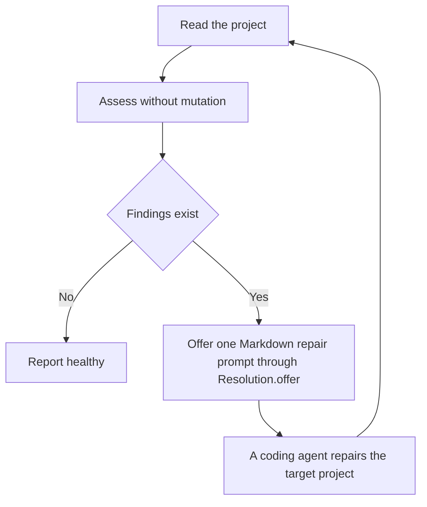

# Architecture

Adamantite is an agent-first preset package and CLI that applies and maintains code-quality
tooling in a target project. Product behavior is documented in the [README](../README.md), and
domain terms live in [GLOSSARY.md](../GLOSSARY.md).

Each section says what an area is for, names the module that owns it, describes how the area
works, and lists its invariants with the rule or the test that holds each one, or `Nothing` when
none does.

## Runtime

`bin/adamantite` loads `dist/index.js`, which Tsdown bundles from `src/index.ts`, beside the
presets. The CLI bundle and the Oxlint entry include Effect and `@effect/platform-node`, so the
package installs neither. `src/index.ts` starts the Effect runtime, `src/cli.ts` defines the
command tree and the services, and each module of `src/commands` defines one command. The Oxlint
entry, `src/oxlint/index.ts`, and the probe plugin, `src/oxlint/probe.ts`, run in Oxlint's process,
and build as `dist/oxlint.js` and `dist/probe.js`.

`makeAppLayer` takes the `CommandRunner` layer as a parameter, so `src/__tests__/cli.test.ts` runs
the same wiring with a runner that starts no process. It provides the local time zone, so the date
that harden gives the agent is the date of the user.

Code that always acts on the target project reads its folder with `yield* Project.Directory`, from
`src/lib/project/index.ts`. Code that callers also run on another folder, such as a trial copy or a
workspace package, takes the folder as a parameter.

A module whose name ends in `.macro.ts` is a build-time macro. Unplugin macros expands each call in
the Tsdown build and in the source transform of Vitest, so the bundle inlines the templates and the
versions and reads neither from disk at run time. `src/lib/shared/version.macro.ts` imports
`package.json` statically, so the macros stay synchronous, and the modules that import them need no
top-level `await`.

| Invariant                                                                                                                                                        | Held by                                                                                                                                             |
| ---------------------------------------------------------------------------------------------------------------------------------------------------------------- | --------------------------------------------------------------------------------------------------------------------------------------------------- |
| A command runs in the target project, the folder that `yield* Project.Directory` gives, and no other code reads or changes the working directory of the process. | `eslint/no-restricted-properties` in `oxlint.config.ts`                                                                                             |
| External behavior is behind the Effect services that `makeAppLayer` in `src/cli.ts` provides, so a test runs a command without changing a real project.          | `project/file-writers` and `adamantite/import-owners`, for the writes and the prompts, and `inMemoryTests` in `config/tests.ts`, for the unit tests |
| The build writes the Oxlint entry and the probe plugin beside the CLI bundle.                                                                                    | `scripts/test-build.ts`                                                                                                                             |
| The package runs under Node.js and Bun.                                                                                                                          | The tests, under Node.js, and the `test` workflow, with the minimum Bun                                                                             |

## Layers

The layer maps in `adamantite/layers` in `oxlint.config.ts` are the only statement of the
layers. Each layer has an explicit `imports` list and can contain another map in `layers`.
Imports are transitive within each map. Declaration order does not change permissions. An import
that breaks a map, or a folder that is not in its map, fails `pnpm run check`.

This table lists each layer of the `src` map and of its nested `lib` map, with the layers that it
imports directly. `src/__tests__/architecture-doc.test.ts` fails when the table and the map
disagree.

| Folder                 | Job                                                                                                                                                                                          | Imports              |
| ---------------------- | -------------------------------------------------------------------------------------------------------------------------------------------------------------------------------------------- | -------------------- |
| `src/commands`         | Define the Effect CLI input of each command, decide its output mode, and compose the lib operations.                                                                                         | `terminal`           |
| `src/terminal`         | Print status lines, findings, setup lines, and JSON documents, prompt the user, hand prompts off through `Resolution.offer`, and print the title.                                            | `lib`                |
| `src/lib`              | Hold the library. Lib code returns data, and never prints a line or asks a question.                                                                                                         | None                 |
| `src/lib/setup`        | Apply a selection with `Setup.apply`: install the packages, set the managed scripts, write the managed files under the write rule, and write the lockfile last.                              | `integrations`       |
| `src/lib/assessment`   | Assess the project with each integration that the selection includes, and render the repair prompt and the warning report.                                                                   | `integrations`       |
| `src/lib/bridge`       | Run the check, fix, and analyze stages, route forwarded arguments, and decide the failure policy.                                                                                            | `integrations`       |
| `src/lib/hardening`    | Find the configs, rules folders, instructions, and Markdown files of the project, count the suppressions, find the discovery gaps, run rule trials, and render the harden prompt.            | `integrations`       |
| `src/lib/integrations` | Hold the `Integration` list and one folder for each integration: its packages, its managed files, its `assess`, and its command builder.                                                     | `handoff`, `project` |
| `src/lib/handoff`      | Detect the installed coding agent CLIs, and hand the terminal to one of them.                                                                                                                | `shared`             |
| `src/lib/project`      | Read the target project: `package.json`, the workspace, the lockfile and its selection, the configs through the config loader, and the custom rules. Detect the package manager and install. | `shared`             |
| `src/lib/shared`       | Define errors, filesystem and JSON helpers, the command runner, the working directory, the forwarded arguments, the public imports, and templates.                                           | None                 |

`setup`, `assessment`, `bridge`, and `hardening` are siblings above `integrations`, so none of
them imports another. `assessment` does not import `hardening`, because harden is not an
assessment. `project` and `handoff` are siblings too. `project` knows target-project files and
package state, but not integration types such as `Finding`. Lib code returns data, and commands
render it, so no lib module imports `terminal`.

`cli.ts`, `index.ts`, and the files in `oxlint/` are entries of the `src` map. An entry imports any
layer, and no layer imports an entry. Tests share the helpers in `src/__tests__`, so the `src` map
does not check them. That ignore does not exempt tests from the `lib` map.

The folders inside the layers belong to the layer that holds them:

| Folder                                            | Job                                                                                                                                                                                                  |
| ------------------------------------------------- | ---------------------------------------------------------------------------------------------------------------------------------------------------------------------------------------------------- |
| `src/lib/integrations/agents`                     | The `agents` integration: `AGENTS.md` with the Adamantite section, and each Adamantite skill in each skill folder.                                                                                   |
| `src/lib/integrations/github`                     | The `github` integration: `.github/workflows/adamantite.yml`.                                                                                                                                        |
| `src/lib/integrations/knip`                       | The `knip` integration: `knip.config.ts`, its Knip config schema, and the Knip command builder.                                                                                                      |
| `src/lib/integrations/oxfmt`                      | The `oxfmt` integration: `oxfmt.config.ts`, the plugin languages, and the Oxfmt command builder.                                                                                                     |
| `src/lib/integrations/oxlint`                     | The `oxlint` integration: `oxlint.config.ts`, the preset catalog, the Oxlint runtime, the Oxlint entry, the probe runner, and the command builder. Also the `oxlint-custom` and `tsrs` integrations. |
| `src/lib/integrations/oxlint/plugins`             | The managed plugins: one definition for each, and the registry that the preset catalog derives.                                                                                                      |
| `src/lib/integrations/oxlint/plugins/effect-tsgo` | The `@effect/tsgo` managed plugin and its runtime resolver.                                                                                                                                          |
| `src/lib/integrations/sherif`                     | The `sherif` integration and the Sherif command builder.                                                                                                                                             |
| `src/lib/integrations/tooling`                    | The package checks that several tools share.                                                                                                                                                         |
| `src/lib/integrations/typescript`                 | The `tsconfig` integration: `tsconfig.json`, and the checks that ask TypeScript which files a config loads.                                                                                          |
| `src/lib/integrations/vscode`                     | The `vscode` integration: `.vscode/settings.json` and `.vscode/extensions.json`.                                                                                                                     |
| `src/lib/integrations/zed`                        | The `zed` integration: `.zed/settings.json`.                                                                                                                                                         |
| `src/lib/project/custom-rules`                    | The rules folders, the `custom()` calls that the loaded configs reach, and the rule stubs of `rule add`.                                                                                             |

`adamantite/import-owners` in `oxlint.config.ts` adds two boundaries that the layers cannot state:

- Only `src` and `scripts` import a module of `src`, so no preset and no preset test imports the
  CLI code.
- Only `src/commands`, `src/terminal`, and the tests import `effect/cli/Prompt`, so lib code never
  asks.

`project/file-writers`, the custom rule in `.adamantite/lint/file-writers.ts`, lets only the file
writers that it lists change the disk. In the non-test files of `src`, it rejects a call to a
`FileSystem` method that writes, such as `writeFileString` or `remove`, and an import of
`ensureDirectory` or `writeFile` from `src/lib/shared/filesystem.ts`. It also rejects `node:fs`
outside the build-time macros, so no write bypasses `FileSystem`.

## Integrations

An integration is one folder in `src/lib/integrations` and one line in the list of
`src/lib/integrations/index.ts`. Each one implements `Integration` from
`src/lib/integrations/base.ts`: `selected`, `packages`, `files`, `assess`, and the optional
`prepare`, which only `vscode` has.

The list holds `oxlint`, `oxfmt`, `knip`, `sherif`, `tsconfig`, `vscode`, `zed`, `github`, and
`agents`. Three more integrations only assess, and `src/lib/assessment/index.ts` runs them first:
`oxlint-custom` in `src/lib/integrations/oxlint/custom.ts`, the managed plugins in
`src/lib/integrations/oxlint/plugins/managed.ts`, and `tsrs` in
`src/lib/integrations/oxlint/tsrs.ts`.

| Invariant                                                                                                                                                                                                                                                          | Held by                                   |
| ------------------------------------------------------------------------------------------------------------------------------------------------------------------------------------------------------------------------------------------------------------------ | ----------------------------------------- |
| The logic of one tool stays in its folder, such as `src/lib/integrations/knip/config.ts`. Only what several integrations share leaves it: `src/lib/integrations/config-file.ts`, `src/lib/integrations/tooling/base.ts`, and `src/lib/integrations/effect-sdk.ts`. | Nothing. `CODING_STANDARDS.md` states it. |
| A command builder is not a member of `Integration`. The `command.ts` of a tool returns `CommandRunOptions` and starts no process, and the bridge and Setup import it.                                                                                              | Nothing                                   |

## Setup and the write rule

`init` and `update` share one backend. `applySetup` in `src/commands/setup.ts` runs `Setup.apply`
from `src/lib/setup/index.ts` with the selection, which `init` takes from its prompts or flags and
`update` from the lockfile. `init` adds its selection to the recorded one with `addSelection` in
`src/lib/project/selection.ts`. It removes no setup, and the TypeScript preset and the CI provider
that it names replace the recorded ones.

`Setup.apply` runs these steps in order:

1. It installs, in one install, `adamantite` at the running version when the project does not
   declare it, and each package of a selected integration that the project does not declare at the
   managed version. A version from a pnpm catalog stays, because `pnpm add` would replace the
   `catalog:` specifier, and the integration's `assess` reports an outdated catalog entry.
2. It runs the `prepare` of each selected integration.
3. It formats each managed file with the project's Oxfmt, which `adamantite fix` runs too, so `fix`
   leaves the file unchanged and its hash still matches. The formatter starts after the install, so
   a project that this setup gives Oxfmt formats with it. A project without an Oxfmt config formats
   with a copy of the format preset in a temporary folder, and a project without Oxfmt gets each
   file as rendered.
4. It sets the managed scripts, after every managed file formats, so a config that Oxfmt cannot load
   fails before a write. It writes `package.json` in the layout that the formatter gives it, and
   only when a script or the install changed it.
5. It writes each managed file under the write rule, and deletes each recorded file that the
   selection no longer renders.
6. It writes the lockfile, formatted the same way, and only when its content changes.

The install uses the package manager that `detectPackageManager` in
`src/lib/project/package-manager.ts` finds: the one that the `packageManager` field of
`package.json` names, or else the one of a lockfile, in the project folder or the nearest folder
above it that has either. A field that names an unsupported package manager does not count. In a
monorepo, `addRootDevDependencies` adds the packages at the workspace root. It clears the cache of
`ModuleResolver` after the install, also when the install fails part way, because the install
changes `node_modules`.

The write rule: `Setup.apply` writes a managed file only whole, and only when the file does not
exist or its hash equals the hash in the lockfile's `written` map. It never merges or edits a file.
Each file gets a `FileWrite`:

| `FileWrite` | When                                                                                         |
| ----------- | -------------------------------------------------------------------------------------------- |
| `Created`   | The file did not exist.                                                                      |
| `Replaced`  | Its hash equaled the recorded hash, so `apply` wrote the current version over it.            |
| `Unchanged` | It already held the current version.                                                         |
| `Kept`      | The user changed it. Its integration's `assess` reports only a change that breaks the setup. |
| `Deleted`   | The selection no longer renders it, and its hash still matched.                              |

Each managed script gets a `ScriptWrite`: `Added`, `Replaced` with the command that it ran, or
`Unchanged`.

| Invariant                                                                                                                                                                  | Held by                                                                                                                                 |
| -------------------------------------------------------------------------------------------------------------------------------------------------------------------------- | --------------------------------------------------------------------------------------------------------------------------------------- |
| `Setup.apply` is the only code that writes the managed files and the lockfile.                                                                                             | `project/file-writers`, which rejects a file write outside the modules that it lists. Nothing checks which file a listed module writes. |
| `Setup.apply` writes the lockfile last, so the lockfile records what the run wrote.                                                                                        | Nothing                                                                                                                                 |
| The write rule holds, and a second run changes no file, because `apply` formats each file with the project's Oxfmt.                                                        | `src/lib/setup/__tests__/index.test.ts`                                                                                                 |
| A config that Oxfmt cannot load fails `apply` before it sets a managed script or writes a managed file or the lockfile. The install and the `prepare` steps run before it. | `src/lib/setup/__tests__/index.test.ts`                                                                                                 |
| A managed script is the one exception to whole files: `apply` sets each selected script of the root `package.json` to its command.                                         | `src/lib/setup/__tests__/index.test.ts`                                                                                                 |
| Each list of a `Selection` holds each item once, in the order of its source list, so two selections of the same setup are equal.                                           | `src/lib/project/__tests__/selection.test.ts`, for `addSelection`                                                                       |

## Lockfile

`src/lib/project/lockfile.ts` owns `.adamantite/adamantite-lock.json`: its schema, its read, and
the hash of a managed file.

`written` maps each file that Adamantite wrote whole, by its path from the project root, to the
hash of the bytes on disk. Each setup computes `written` again from the files that it created,
replaced, or found unchanged, so a file that the user changed leaves it. Without a recorded hash,
such as in a project without a lockfile, a file that exists gets a hash only when it already holds
the current version.

`readLockfile` decodes the schema version first, because it decides which schema reads the rest. It
decodes the Adamantite version leniently, because a newer schema can change its type. A schema
version that this Adamantite does not know fails with `UnsupportedLockfile`, and a lockfile that
does not decode fails with `InvalidLockfile`. `readSelection` gives none for both, and Doctor
reports them.

`verifyLockfileVersion` compares the recorded version with the version that the project installs,
not the running one, so a CLI from another install, such as `npx`, judges the project as the
project's own CLI does. `readInstalledVersion` in `src/lib/project/adamantite-version.ts` resolves
`adamantite/lint` as Oxlint loads the preset, so an install in a parent `node_modules`, such as at
the root of a monorepo, counts. A project that installs no Adamantite passes, because Oxlint cannot
load the presets either and reports it. A newer release than the installed one fails with
`SetupAhead`, whose repair is an install, because `update` would bring the setup back to the
installed version. Any other difference fails with `SetupOutdated`, whose repair is `update`. A
version that does not start with release numbers, such as a git source, compares as older, and so
do two prereleases of one release, because `update` with the installed version then ends the drift.

| Invariant                                                                                                                                                                                                      | Held by                                                                            |
| -------------------------------------------------------------------------------------------------------------------------------------------------------------------------------------------------------------- | ---------------------------------------------------------------------------------- |
| A lockfile that does not decode, or that has a schema version that this Adamantite does not know, fails `init` and `update` before they change a file.                                                         | `src/commands/__tests__/init.test.ts` and `src/commands/__tests__/update.test.ts`  |
| A lockfile that another Adamantite version than the installed one wrote fails `check` after its stages, and Doctor reports it as a finding. `verifyLockfileVersion` is the one comparison of the two versions. | `src/commands/__tests__/check.test.ts` and `src/commands/__tests__/doctor.test.ts` |
| `Project.read` decodes the lockfile one time, and the rest of the code trusts `project.lockfile`.                                                                                                              | Nothing                                                                            |

## Assessment

`Project.read` in `src/lib/project/index.ts` reads the target project one time into a snapshot.
`assessProject` in `src/lib/assessment/index.ts` gives the snapshot to the `assess` of each
integration that the lockfile's selection includes.

`Project.read` reads `package.json`, the workspace, and the lockfile, and discovers the custom
rules. It takes the root `oxlint.config.ts` from the reads of the discovery, which tries
`oxlint.config.ts` first, because each load starts a Node.js process. The workspace patterns are
the `packages` of `pnpm-workspace.yaml`, or the `workspaces` of `package.json` when
`pnpm-workspace.yaml` declares none, because that file can hold only settings, such as
`allowBuilds`. A `pnpm-workspace.yaml` that does not parse declares no pattern and no catalog. A
project that declares patterns is a monorepo, also before any package exists. A workspace package
is a folder with a `package.json` that matches an include pattern and no `!` pattern, outside
`node_modules` and the folders whose names start with a dot. A command that reads the workspace
outside a snapshot, such as `harden` or `rule try`, reads it one time for each phase and passes the
`Workspace` down.

`readAssessment` reads the root `package.json` first, so a project that does not declare
`adamantite` gets its one finding, also when its workspace packages do not read. A lockfile that is
missing or does not read also gives one finding, because the other assessments need the selection.
Any other read failure fails Doctor. `assessProject` runs the assess-only integrations, which decide
from the project whether they apply, then the integrations that the selection includes, in the
order of their lists, which numbers the findings. The findings start with the version finding of
`verifyLockfileVersion`, the error that `check` fails with, so Doctor calls no project healthy that
`check` fails. The findings of the managed scripts follow, under the integration name `scripts`,
because no integration owns the scripts. `renderAssessmentMarkdown` renders findings into the repair
prompt with the warnings folded in, and renders a warning-only assessment into the warning report.



| Invariant                                                                                                                          | Held by                                 |
| ---------------------------------------------------------------------------------------------------------------------------------- | --------------------------------------- |
| `assess` and `doctor` never change the project. A coding agent or the user repairs it, and a later assessment confirms the repair. | `project/file-writers`                  |
| Each reassessment reads a new snapshot, because a handoff or an install changes the project.                                       | Nothing                                 |
| A project without a lockfile, with a lockfile that does not read, or without `adamantite` gets one finding alone.                  | `src/commands/__tests__/doctor.test.ts` |
| Package drift stays structured as package actions, so `update` installs the managed versions.                                      | `src/commands/__tests__/update.test.ts` |

## Resolution and output modes

`Resolution.offer` in `src/terminal/resolution.ts` is the one way that a command hands a prompt to
a coding agent, and `CodingAgents` in `src/lib/handoff/coding-agents.ts` does the handoff. A
`Repair` fails the command while findings remain, and a `Task`, such as harden, is work that the
user can decline. The command decides its mode once, with `Mode.provide` from
`src/terminal/mode.ts`, and a command that decides none prints as `Plain`:

| Mode    | When                                                 | The offer                                                                                                |
| ------- | ---------------------------------------------------- | -------------------------------------------------------------------------------------------------------- |
| `Json`  | With `--json`.                                       | Prints the command's JSON document on standard output. The command never asks and never starts an agent. |
| `Menu`  | When the terminal can prompt and the user allows it. | Shows the resolution menu of `src/terminal/resolution-menu.ts`.                                          |
| `Plain` | Otherwise.                                           | Prints the Markdown prompt.                                                                              |

`CodingAgents.detectInstalled` probes the CLI of each entry of `codingAgents` and keeps the order of
the list for the menu. A CLI that starts and exits within 10 seconds is installed, whatever its
output or exit code. `CodingAgents.handoff` starts the agent with the prompt in its arguments and
the standard streams of the terminal. It ignores SIGINT until the session ends, so a Ctrl-C reaches
only the agent, and it discards the exit code of the agent.

| Invariant                                                                                                            | Held by                                                                               |
| -------------------------------------------------------------------------------------------------------------------- | ------------------------------------------------------------------------------------- |
| After an agent session, only the command's `verify` decides success.                                                 | The tests in `src/commands/__tests__`                                                 |
| The handoff passes no permission, sandbox, or trust flag of a coding agent.                                          | Nothing                                                                               |
| With `--json`, standard output holds only the JSON document, which decodes with the Schema that the command exports. | The tests in `src/commands/__tests__`, and `scripts/test-smoke.ts` for the packed CLI |

## Reading configs, comments, and syntax trees

Adamantite takes each fact about the target project from the tool that owns it, and does not parse
source text. Nothing enforces it.

| Fact                                               | Source                                                                                                                                                                                                                                                                                                                                                                                                                  |
| -------------------------------------------------- | ----------------------------------------------------------------------------------------------------------------------------------------------------------------------------------------------------------------------------------------------------------------------------------------------------------------------------------------------------------------------------------------------------------------------- |
| A tool config                                      | The `ConfigLoader` service in `src/lib/project/config-loader.ts` imports the config with Node.js in a separate process, as Oxlint imports it. Each preset and each `custom()` result names itself under the symbol of `presets/identity.ts`, so a preset counts also through a spread. `src/lib/project/__tests__/config-loader.test.ts` runs the real loader, and the unit tests use `src/__tests__/config-loader.ts`. |
| The disable comments and the syntax tree of a file | The probe plugin, `src/oxlint/probe.ts`, reports them from Oxlint's parser, and `src/lib/integrations/oxlint/probe.ts` runs it.                                                                                                                                                                                                                                                                                         |
| The files that Oxlint lints, and its reports       | `src/lib/integrations/oxlint/files.ts`                                                                                                                                                                                                                                                                                                                                                                                  |

`ConfigLoader.load` runs each config in its own Node.js process, so the output of the config cannot
reach the output of a command, and a later load reads the files again after a coding agent changes
a module that the config imports. The process runs in the folder that `adamantite check` starts
Oxlint in, so a config that reads a file through `process.cwd()` reads the file that Oxlint reads.
It prints the encoded default export after a marker, apart from what the config prints. It passes
`--debug=files`, the argument of Oxlint's read-only file listing, so `custom()` writes the entry
module of a rules folder outside the project. `ENCODE_SOURCE` copies the identity of each preset and
each `custom()` result under the `$adamantite` key, because JSON drops symbol keys, and writes a
regular expression, which Knip accepts in place of a name, as `{ $regexp, flags }`. The in-memory
loader of the unit tests runs the same source. `readConfig` gives a config that does not load, or
that its schema rejects, as a failed `Result`, because a finding reports it.

`src/lib/project/lint-config.ts` reads a loaded Oxlint config. Its schema leaves the setting of each
rule unknown, so a setting that Adamantite does not read never fails the decode of a config that
Oxlint loads. A preset that a config spreads into its own object counts at the place of that object.
An override that spreads a preset names the preset itself, and an override that spreads the `rules`
of a preset, as the documentation of the jest and vitest presets shows, names it in `rules`. A
config that spreads a preset, such as `{ ...core, overrides }`, keeps the identity of the preset on
its own object, so `listOverrides` cannot tell the overrides of the project from those of the
preset.

`ModuleResolver` in `src/lib/project/module-resolver.ts` resolves a specifier to the file that
Node.js loads. Custom rule discovery clears its cache before each traversal, because a coding agent
can change the project between two assessments of one command.

## Command boundaries

Each command is one module of `src/commands`:

| Command        | Work                                                                                                                                                                                           |
| -------------- | ---------------------------------------------------------------------------------------------------------------------------------------------------------------------------------------------- |
| `check`, `fix` | Run Oxfmt and Oxlint through the bridge, `src/lib/bridge/index.ts`. `check` fails on Oxlint warnings unless `--allow-warnings` is set.                                                         |
| `analyze`      | Run Sherif in a detected monorepo, then Knip, through the bridge.                                                                                                                              |
| `init`         | Add the selection of its prompts or flags to the recorded selection, and run `applySetup`.                                                                                                     |
| `update`       | Run `applySetup` with the recorded selection.                                                                                                                                                  |
| `doctor`       | Assess the project, and offer the repair of its findings.                                                                                                                                      |
| `harden`       | Offer a prompt that tells a coding agent to move the project's coding standards up the enforcement ladder, from the facts that `src/lib/hardening/index.ts` computes. It produces no findings. |
| `rule`         | Write a custom rule stub, print a syntax tree, run the saved rule tests, and run a trial in a copy of the project through `src/lib/hardening/trial.ts`.                                        |

By default, `check` fails on Oxlint warnings, because agents copy the code that they read, and a
warning that passes `check` spreads like code that has no report. It runs its stages before it
compares the lockfile version, so an agent that runs `check` after an edit reads the reports of its
code before the setup repair. A lockfile that fails with `InvalidLockfile` or `UnsupportedLockfile`
leaves the stages as without a lockfile, and Doctor reports it.

Without a lockfile, `update` has no selection to apply, so it offers the one finding, which names
`adamantite init`.

In a target project, `harden` runs only when the Adamantite version in `node_modules` is the
running version, because the prompt offers the presets and rules of that version. The Adamantite
repository does not install itself, so there `harden` compares the running version with the
`version` of the root `package.json`, and does not check `node_modules`. After an agent session,
`verify` in `src/commands/harden.ts` runs the checks of the bridge, reads the project again, and
assesses it. A failed check, or a finding that remains, fails the session. A failed command already
printed its report, so only another failure, such as a missing tool, adds its message. A link that
was broken before the session, or a line of the decisions record that did not decode before it, is
a gap that the user may not have approved, so a broken link or an undecodable line fails the
session only when the session added it. A line has no key that survives a repair, so `verify`
compares the text of the lines.

The bridge runs its stages through `CommandRunner` in `src/lib/shared/command-runner.ts`. A stage is
an effect that finds its command, such as the Oxlint stage, which resolves the Oxlint runtime of the
project, and a stage that finds no command prints no section. `runAll` runs every stage in order,
then fails with the first failure, and `runUntilFailure` stops at the first failure.
`runConcurrently` finds every command before any command starts, starts them together, and prints
each section after the sections before it, so its output reads as the output of `runAll`. It fails
first with a stage that found no command, because the stages that ran already printed why they
failed.

- `check` runs the format stage and the lint stage at the same time, because both only read files.
- `fix` runs the lint stage before the format stage, so `quality/require-readable-spacing` counts a
  line past the print width as multiline before Oxfmt wraps it.
- `analyze` runs Sherif only in a monorepo. A project without a usable `package.json` has no
  monorepo, and Knip reports the manifest. Another read failure, such as of `pnpm-workspace.yaml`,
  could hide a monorepo, so it fails the command. With `--fix`, the stages stop at the first
  failure.

A missing tool fails with `CliNotFound` when the tool runs from `PATH`, and with
`PackageNotInstalled` when Node.js starts it from the project. The bridge replaces the failure with
`ToolNotSelected` when the recorded selection includes no script that runs the tool, because
`update` would not install it. The Oxlint entry does the same for Oxlint.

| Invariant                                                                                                                                                                                                                   | Held by                                                                                                 |
| --------------------------------------------------------------------------------------------------------------------------------------------------------------------------------------------------------------------------- | ------------------------------------------------------------------------------------------------------- |
| Only `check`, `fix`, and `analyze` forward the arguments after `--`. The bridge gives them to one stage: the lint stage, the unused stage of `analyze`, or the stage that `--only` selects.                                 | `src/__tests__/cli.test.ts`, for the commands, and the tests in `src/commands/__tests__`, for the stage |
| A missing tool that no selected script runs fails with `ToolNotSelected`, which names the `init` command that adds the script.                                                                                              | The tests in `src/commands/__tests__`                                                                   |
| A trial changes no file of the project.                                                                                                                                                                                     | `src/lib/hardening/__tests__/trial.test.ts`                                                             |
| `harden` fails before it computes its context when the Adamantite version that it reads is not the running version. It reads the version from `node_modules`, or in the Adamantite repository from the root `package.json`. | `src/commands/__tests__/harden.test.ts`                                                                 |
| A broken link or an undecodable line of the decisions record fails the session of `harden` only when the session added it.                                                                                                  | `src/commands/__tests__/harden.test.ts`                                                                 |
| `rule try` exits 0 when each case is as expected, 1 when a case is not, and 2 when the trial is not evidence.                                                                                                               | `src/commands/__tests__/rule.test.ts`                                                                   |
| Oxlint applies one pass of fixes, so some fixes need a second `fix`, until Oxlint repeats its passes ([oxc#16118](https://github.com/oxc-project/oxc/issues/16118)).                                                        | `secondPasses` in `presets/__tests__/idioms.ts`, which `src/lib/bridge/__tests__/index.test.ts` reads   |

## Preset layout

```text
presets/
  __tests__/        the stack and fixture tests, and the fixture packages
  identity.ts       the symbol key under which each preset and custom() result names itself
  lint/             published Oxlint presets
    plugins/        first-party Oxlint plugins, one folder for each rule namespace
      entry.ts      the jsPlugins entry of each plugin, for the presets
      shared/       helpers that more than one plugin uses
      adamantite/   the adamantite rules
      quality/        the quality rules of the strict preset
      quality-effect/ the quality-effect rules of the effect preset
      testing/        the testing rules of the strict preset
  rules/            published rules-folder preset, authoring API, loader, and test API
  analyze.ts        published Knip preset
  format.ts         published Oxfmt preset
  tsconfig.json     published TypeScript preset with strict options
  typescript.json   published TypeScript preset with strict options and ts-reset types
  typescript/
    resets/         first-party type resets
```

Adamantite reads the configs of a target project by loading them, as Oxlint, Oxfmt, and Knip do, so
it sees plain objects and not the imports that built them. Each preset object therefore names its
public module under `PRESET`, the `Symbol.for("adamantite.preset")` key of `presets/identity.ts`.
`Symbol.for` gives one key to every installed copy of Adamantite, and a spread copies the key, so a
config such as `{ ...analyze, ignoreDependencies }` keeps it. The tools ignore the key: Oxlint and
Oxfmt send the config to Rust as JSON, and Knip reads only string keys. `presets/analyze.ts` and
`presets/format.ts` write the key with `Symbol.for`, because `presets/tsconfig.json` sets the
options of their folder and does not allow a value import with a `.ts` extension.

| Invariant                                                                                                | Held by                              |
| -------------------------------------------------------------------------------------------------------- | ------------------------------------ |
| `adamantite/analyze`, `adamantite/format`, and each lint preset name their public module under `PRESET`. | `presets/__tests__/identity.test.ts` |

## Dependency version invariant

An integration records the version of each package that Adamantite installs in target projects,
from the build-time version of the dependency in `package.json`. Packages that belong to Oxlint sit
under `src/lib/integrations/oxlint`: tsrs beside the integration, and the managed plugins in
`src/lib/integrations/oxlint/plugins`. The Oxlint integration installs tsrs and the managed plugin
of each selected preset. `getDependencyVersion` in `src/lib/shared/version.macro.ts` fails the build
for a package that `package.json` does not declare.

## Lint presets

`LINT_PRESETS` in `src/lib/project/selection.ts` is the one list of the presets that a target
project can select besides core, in the order that `init` offers them, and
`src/lib/integrations/oxlint/presets.ts` gives each one a definition. The list sits in `project`
because the `Selection` schema needs it below the integrations. The [README](../README.md#presets) describes what each preset checks.

`jest` and `vitest` put their rules in one override for their `testFiles`, and keep `plugins` and
`rules` as properties that `Object.defineProperties` does not make enumerable. Oxlint reads a config
through `JSON.stringify`, which skips them, so a config that extends the preset gets only the
override, and a project can spread `plugins` and `rules` into an override of its own. The rules
name the preset under `PRESET` too, so Doctor counts such an override as the preset. The two presets
load no first-party plugin, because a project override that copies their `plugins` and `rules`
would not load it. `strict` turns on its assertion and testing rules for the `testFiles` of both
presets, so the presets agree on what a test is.

The `effect` preset turns on the native `effecttsgo` rules of `@effect/tsgo`, which only the Effect
builds of the Oxlint binding and of tsrs have. It enables the rules that report Effect code, and none
that bans a platform API in code that is not Effect code. `EXCLUDED_RULES` in
`presets/__tests__/effect.test.ts` lists each rule of the four category presets of `@effect/tsgo`
that the preset leaves out, with the reason, and the test fails when a category preset adds a rule
that is in neither list. The preset also enables every rule of the first-party `quality-effect`
plugin.

| Invariant                                                                                                                                                                                                                              | Held by                                                                                                               |
| -------------------------------------------------------------------------------------------------------------------------------------------------------------------------------------------------------------------------------------- | --------------------------------------------------------------------------------------------------------------------- |
| Each preset of the list has a definition and a file in `presets/lint`.                                                                                                                                                                 | The type of `definitions`, and `src/lib/integrations/oxlint/__tests__/presets.test.ts`                                |
| `package.json` exports core as `adamantite/lint` and each preset as `adamantite/lint/<name>`, without a wildcard, so the other modules below `presets/lint` stay private. The export map, the list, and the README import table agree. | `src/lib/integrations/oxlint/__tests__/presets.test.ts`, `src/__tests__/exports.test.ts`, and `scripts/test-smoke.ts` |
| CLI code gets a public import from `publicImport()` in `src/lib/shared/package-exports.ts`, which accepts only a key of the export map. Prose in findings and prompts keeps literal imports.                                           | The type checker. Nothing rejects a literal import.                                                                   |
| A config that extends `jest` or `vitest` gets their rules only in the test files, and a project override that spreads its `plugins` and `rules` gets each rule.                                                                        | `presets/__tests__/jest.test.ts` and `presets/__tests__/vitest.test.ts`                                               |
| Each lint preset besides core is in a stack of `presets/__tests__/stacks.ts`.                                                                                                                                                          | `presets/__tests__/stacks.test.ts`                                                                                    |
| Each `effecttsgo` rule of the `effect` preset is in a category preset of `@effect/tsgo`, and the preset decides on each rule of those presets.                                                                                         | `presets/__tests__/effect.test.ts`                                                                                    |

## Managed plugins

A preset can need a third-party Oxlint plugin from npm, such as `@shadcn/lint` for `tailwind`.
`src/lib/integrations/oxlint/plugins` holds one definition for each, and
`src/lib/integrations/oxlint/runtime.ts` resolves the Oxlint runtime, with the native parts that a
plugin replaces.

| Invariant                                                                                                                                                                                                                                      | Held by                                                                                                   |
| ---------------------------------------------------------------------------------------------------------------------------------------------------------------------------------------------------------------------------------------------- | --------------------------------------------------------------------------------------------------------- |
| Each plugin package has a managed version.                                                                                                                                                                                                     | The type of `versions` in `src/lib/integrations/oxlint/plugins/managed.ts`                                |
| No module that the Oxlint entry loads imports a version macro, so the entry runs from source.                                                                                                                                                  | The `presets` tests, which start `src/oxlint/index.ts` through `presets/__tests__/rule-fixtures.ts`       |
| One resolver serves the CLI, the Oxlint entry, and Doctor, so `src/lib/integrations/oxlint/runtime-assessment.ts` reports what a lint run finds.                                                                                               | Nothing holds the shared use. `src/lib/integrations/oxlint/__tests__/runtime.test.ts` holds the resolver. |
| The resolver reads files and changes nothing. Only a process that starts Oxlint applies the `OxlintLaunch` of a runtime: the CLI starts Oxlint's CLI module with it, and the Oxlint entry, which editors start, applies it in its own process. | Nothing                                                                                                   |
| Only the Effect plugin replaces native parts, so no two overrides replace one part.                                                                                                                                                            | Nothing                                                                                                   |

## Type resets

`adamantite/typescript` loads the type resets in `presets/typescript/resets`, through
`presets/typescript/resets/index.d.ts`. The resets change the types of built-in APIs. Doctor
reports a library that loads them, from `src/lib/integrations/typescript/index.ts`.

| Invariant                                                                                                                                                                                                    | Held by                                |
| ------------------------------------------------------------------------------------------------------------------------------------------------------------------------------------------------------------ | -------------------------------------- |
| Each reset has a fixture of type tests in `src/__tests__/presets/fixtures/typescript` that passes with `adamantite/typescript` and fails with `adamantite/tsconfig`, and `index.d.ts` references each reset. | `presets/__tests__/typescript.test.ts` |
| The build ships each file that the built preset loads.                                                                                                                                                       | `scripts/test-build.ts`                |

## First-party plugins

Adamantite has four Oxlint plugins of its own in `presets/lint/plugins`: `adamantite`, `quality`
and `testing` for the `strict` preset, and `quality-effect` for the `effect` preset. A preset gets
the `jsPlugins` entry of a plugin from `firstPartyPlugin` in `presets/lint/plugins/entry.ts`. The
`architecture` preset loads the `adamantite` plugin without enabling rules, because
`adamantite/layers` and `adamantite/import-owners` need options from the target project.

| Invariant                                                                                                                                                                                                             | Held by                                                                                                                                |
| --------------------------------------------------------------------------------------------------------------------------------------------------------------------------------------------------------------------- | -------------------------------------------------------------------------------------------------------------------------------------- |
| The folder name of a plugin is its rule namespace and its `meta.name`.                                                                                                                                                | `presets/lint/plugins/__tests__/entry.test.ts`                                                                                         |
| Rule code runs under the runtime that executes Oxlint in the target project. It imports only types from `@oxlint/plugins`, and its one runtime package is `oxc-resolver`.                                             | The preset build in `tsdown.config.ts`, which fails when it bundles another package. Nothing rejects an API that only one runtime has. |
| `presets/lint/plugins/tsconfig.json` lets the source import rule modules with their `.ts` extension, which Node.js needs to load a plugin from source.                                                                | The `presets` tests                                                                                                                    |
| Each rule has a RuleTester test, and a `valid` and an `invalid` fixture that a real Oxlint run lints through `presets/__tests__/rule-fixtures.ts`. [Place a test](../CONTRIBUTING.md#place-a-test) names the folders. | `presets/__tests__/stacks.test.ts`, for the fixtures. Nothing requires the RuleTester test.                                            |
| No rule of a stack reports a valid fixture, and each invalid fixture gets the report of its rule. A report that stays is in `knownReports`.                                                                           | `presets/__tests__/stacks.test.ts`                                                                                                     |
| No two presets set one rule, unless one of them is core. Each core rule that a preset changes has a fixture that gets a different result from core alone.                                                             | `presets/__tests__/overlap.test.ts`                                                                                                    |
| The fixture packages in `presets/__tests__/fixture-packages` are a separate pnpm workspace, and no package is in both manifests.                                                                                      | `presets/__tests__/fixture-packages.test.ts`, for the manifests. Nothing checks the workspace file.                                    |
| A rule declares the hand-written config that it replaces in `meta.docs.replaces`, so `src/lib/integrations/oxlint/replacements.ts` names no rule.                                                                     | `src/lib/integrations/oxlint/__tests__/replacements.test.ts`                                                                           |
| Each `license.md` below `presets` ships at the same path in `dist/presets`.                                                                                                                                           | `scripts/test-build.ts`                                                                                                                |

## Custom rules

Custom rules are Oxlint rules that the target project writes in a rules folder, by default
`.adamantite/lint`. `presets/rules` is the published side: `custom()`, the loader, the authoring
API, and the test API. `src/lib/project/custom-rules` is the CLI side: the discovery of the
`custom()` calls that the loaded configs reach, the stub of `rule add`, and the saved tests of
`rule test`. `skills/adamantite-hardening/references/custom-rules.md`, which the "Custom rules"
section of `skills/adamantite-hardening/SKILL.md` links to, tells an agent how to write and verify
a rule.

`custom()` in `presets/rules/custom.ts` runs while Oxlint loads the config. It finds the file that
called it in the stack, resolves `dir` from that file, and turns on each rule file that
`listRuleFiles` in `presets/rules/folder.ts` lists: a regular file directly in the folder, not a
symlink, whose extension is `.js`, `.mjs`, `.mts`, or `.ts`, that is not a declaration or a test
file, and whose name does not start with `_`. Helpers live in `_` files and in subfolders. Oxlint
then loads an entry module that calls `loadRules` from `presets/rules/load.ts` for the folder.
`presets/rules/folder.ts` holds what `custom()`, `loadRules`, and the CLI share, and the export map
does not list it.

`writeEntryModule` writes the entry module to `node_modules/.cache/adamantite` above the rules
folder, or to a folder in the OS temporary directory that only the current user can write. The
file name hashes the folder, the plugin name, and the URL of `loadRules`, so each rules folder and
each installed copy of Adamantite gets its own file. Oxlint's `--debug=files` run, which the file
discovery of Adamantite uses, writes the entry module to the temporary folder, so discovery changes
nothing in the project. The result names the folder, the plugin, and the caller under `PRESET` also
when the folder holds no rule, so Adamantite finds each rules folder that a loaded config reaches.

`adamantite/rules/testing` connects RuleTester to `node:test`, so a rule test reports each case and
sets the exit code. It is a separate export from `adamantite/rules/plugin`, so importing
`adamantite/rules/plugin` does not load `node:test`.

`discoverCustomRules` in `src/lib/project/custom-rules/discover.ts` loads the Oxlint configs that
lint the given folders, as Oxlint loads them, so a `custom()` call in a module that a config
imports, such as the entry module of a shared tooling package, counts, and a call in a module that
no config imports does not. Each config loads in the project root. A config that does not load is
in `unloadedConfigs`, with its reason. `readCustomRuleTestCommand` in
`src/lib/project/custom-rules/index.ts` runs the saved tests of each rules folder that a call loads
with `node --test`, also in a Bun project.

| Invariant                                                                                                                                                         | Held by                                                                                                              |
| ----------------------------------------------------------------------------------------------------------------------------------------------------------------- | -------------------------------------------------------------------------------------------------------------------- |
| `custom()` and the loader use only the Node.js APIs that Bun also provides.                                                                                       | `presets/__tests__/custom.test.ts`, in real Oxlint runs under Node.js, and the `test` workflow, with the minimum Bun |
| A project type-checks its rules without `@oxlint/plugins`, because the build inlines the authoring types.                                                         | `scripts/test-smoke.ts`                                                                                              |
| `presets/lint/tsconfig.json` and `presets/rules/tsconfig.json` extend the root config, so type-aware lint sees the Node.js types and the `.ts` import extensions. | `pnpm run check`                                                                                                     |
| Only `adamantite rule test` runs a saved test, and no temporary verification case stays in the target project.                                                    | Nothing. The hardening skill asks it of the agent.                                                                   |
| Two files for one rule name, such as `no-foo.js` and `no-foo.ts`, fail the lint run.                                                                              | `presets/__tests__/custom.test.ts`                                                                                   |
| A rule that throws in a visitor fails the lint run with a plugin error, as the custom rules reference of the hardening skill tells agents.                        | `presets/__tests__/custom.test.ts`                                                                                   |
| Two installed copies of Adamantite that load one rules folder write two entry modules.                                                                            | `presets/__tests__/custom.test.ts`                                                                                   |
| The fallback folder of the entry modules is one that only the current user can write.                                                                             | `presets/__tests__/custom.test.ts`, except on Windows, which gives each user a temporary directory                   |
| A `--debug=files` run writes no entry module in the project.                                                                                                      | Nothing                                                                                                              |
