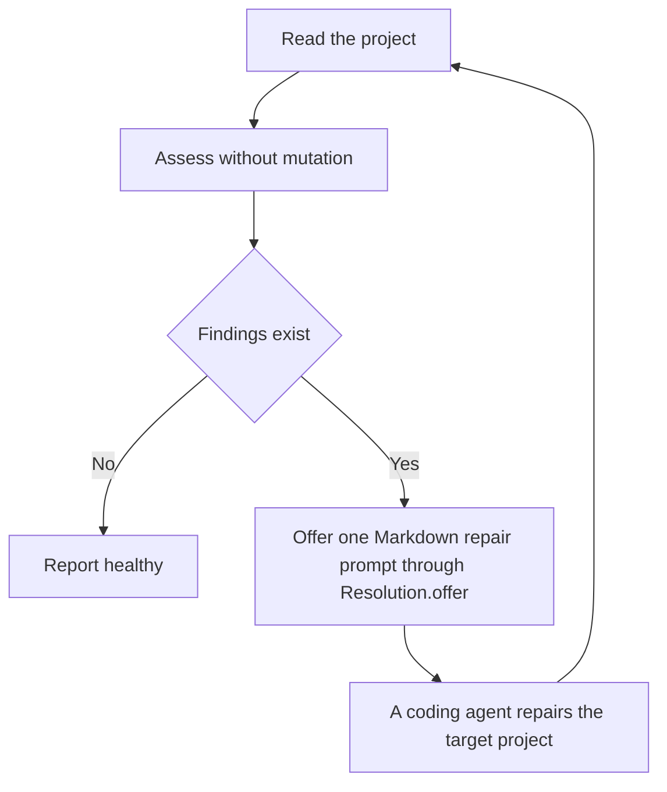

# Architecture

Adamantite is an agent-first preset package and CLI that applies and maintains code-quality
tooling in a target project. Product behavior is documented in the [README](../README.md), and
domain terms live in [GLOSSARY.md](../GLOSSARY.md).

## Runtime

`src/index.ts` starts the Effect runtime. `src/cli.ts` defines the command tree and command
options. Command modules validate command-specific input, obtain Effect services, and
invoke target-project operations.

`@effect/platform-node` supplies the production filesystem, path, process, and terminal
services. Other external behavior, such as prompts and child commands, is also behind
services so command behavior can be tested without changing a real project.

Tsdown bundles the CLI, the Oxlint entry, the probe plugin, and the presets into `dist`. Unplugin
macros expands compile-time package metadata and terminal-title values during builds and Vitest
source transforms. The `bin/adamantite` executable loads the bundled CLI. `src/oxlint.ts` builds to
`dist/oxlint.js`, beside the CLI bundle, and runs Oxlint with the project's Oxlint runtime. The
entry imports no macro module, so this repository runs it from source with
`node src/oxlint.ts`. `src/probe.ts` builds to `dist/probe.js`, the Oxlint plugin that
"Reading configs, comments, and syntax trees" describes. Repository tests run with Vitest
under Node.js. A packaged smoke test keeps Bun runtime compatibility covered.

## Layers

The layer maps in `adamantite/layers` in `oxlint.config.ts` are the only statement of the
layers. Each layer has an explicit `imports` list and can contain another map in `layers`.
Imports are transitive within each map. Declaration order does not change permissions. An import
that breaks a map, or a folder that is not in its map, fails `pnpm run check`.

This table lists each layer of the `src` map and of its nested `lib` map, with the layers that it
imports directly. `src/__tests__/architecture-doc.test.ts` fails when the table and the map
disagree.

| Folder                 | Job                                                                                                                                                                                          | Imports              |
| ---------------------- | -------------------------------------------------------------------------------------------------------------------------------------------------------------------------------------------- | -------------------- |
| `src/commands`         | Define the Effect CLI input of each command, decide its output mode, and compose the lib operations.                                                                                         | `terminal`           |
| `src/terminal`         | Print status lines, findings, setup lines, and JSON documents, prompt the user, hand prompts off through `Resolution.offer`, and print the title.                                            | `lib`                |
| `src/lib`              | Hold the library. Lib code returns data, and never prints a line or asks a question.                                                                                                         | None                 |
| `src/lib/setup`        | Apply a selection with `Setup.apply`: install the packages, set the managed scripts, write the managed files under the write rule, and write the lockfile last.                              | `integrations`       |
| `src/lib/assessment`   | Assess the project with each integration that the selection includes, and render the repair prompt and the warning report.                                                                   | `integrations`       |
| `src/lib/toolchain`    | Run the check, fix, and analyze stages, route forwarded arguments, and decide the failure policy.                                                                                            | `integrations`       |
| `src/lib/hardening`    | Find the configs, rules folders, instructions, and Markdown files of the project, count the suppressions, find the discovery gaps, run rule trials, and render the harden prompt.            | `integrations`       |
| `src/lib/integrations` | Hold the `Integration` list and one folder for each integration: its packages, its managed files, its `assess`, and its command builder.                                                     | `handoff`, `project` |
| `src/lib/handoff`      | Detect the installed coding agent CLIs, and hand the terminal to one of them.                                                                                                                | `shared`             |
| `src/lib/project`      | Read the target project: `package.json`, the workspace, the lockfile and its selection, the configs through the config loader, and the custom rules. Detect the package manager and install. | `shared`             |
| `src/lib/shared`       | Define errors, filesystem and JSON helpers, the command runner, the forwarded arguments, the public imports, and templates.                                                                  | None                 |

`setup`, `assessment`, `toolchain`, and `hardening` are siblings above `integrations`, so none of
them imports another. `assessment` does not import `hardening`, because harden is not an
assessment. `project` and `handoff` are siblings too. `project` knows target-project files and
package state, but not integration types such as `Finding`. Lib code returns data, and commands
render it, so no lib module imports `terminal`.

`cli.ts`, `index.ts`, `oxlint.ts`, and `probe.ts` are entries of the `src` map. An entry imports any
layer, and no layer imports an entry. Tests share the helpers in `src/__tests__`, so the `src` map
does not check them. That ignore does not exempt tests from the `lib` map.

The folders inside the layers belong to the layer that holds them:

| Folder                                            | Job                                                                                                                                                                                                  |
| ------------------------------------------------- | ---------------------------------------------------------------------------------------------------------------------------------------------------------------------------------------------------- |
| `src/commands/init`                               | The `init` command: its flags, its prompts, and the checks that turn them into a selection.                                                                                                          |
| `src/lib/integrations/agents`                     | The `agents` integration: `AGENTS.md` with the Adamantite section, and the Adamantite skill in each skill folder.                                                                                    |
| `src/lib/integrations/github`                     | The `github` integration: `.github/workflows/adamantite.yml`.                                                                                                                                        |
| `src/lib/integrations/knip`                       | The `knip` integration: `knip.config.ts`, its Knip config schema, and the Knip command builder.                                                                                                      |
| `src/lib/integrations/oxfmt`                      | The `oxfmt` integration: `oxfmt.config.ts`, the plugin languages, and the Oxfmt command builder.                                                                                                     |
| `src/lib/integrations/oxlint`                     | The `oxlint` integration: `oxlint.config.ts`, the preset catalog, the Oxlint runtime, the Oxlint entry, the probe runner, and the command builder. Also the `oxlint-custom` and `tsrs` integrations. |
| `src/lib/integrations/oxlint/plugins`             | The managed plugins: one definition for each, and the registry that the preset catalog derives.                                                                                                      |
| `src/lib/integrations/oxlint/plugins/effect-tsgo` | The `@effect/tsgo` managed plugin and its runtime resolver.                                                                                                                                          |
| `src/lib/integrations/sherif`                     | The `sherif` integration and the Sherif command builder.                                                                                                                                             |
| `src/lib/integrations/tooling`                    | The package checks that several tools share.                                                                                                                                                         |
| `src/lib/integrations/typescript`                 | The `tsconfig` integration: `tsconfig.json`, and the checks that ask TypeScript which files a config loads.                                                                                          |
| `src/lib/integrations/vscode`                     | The `vscode` integration: `.vscode/settings.json` and `.vscode/extensions.json`.                                                                                                                     |
| `src/lib/integrations/zed`                        | The `zed` integration: `.zed/settings.json`.                                                                                                                                                         |
| `src/lib/project/custom-rules`                    | The rules folders, the `custom()` calls that the loaded configs reach, and the rule stubs of `rule add`.                                                                                             |

`adamantite/import-owners` in `oxlint.config.ts` narrows these imports further:

- Only `src` and `scripts` import a module of `src`, so no preset and no preset test imports the
  CLI code.
- Only `src/lib` and the tests import an integration folder. `init` also imports
  `integrations/oxlint` for the preset catalog, and the Oxlint entry imports it for the runtime.
  The other commands go through `lib/setup`, the assessment, and Toolchain.
- Only `src/commands/setup.ts`, `src/commands/update.ts`, and `src/terminal/setup.ts` import
  `#lib/setup`.
- Only `lib/setup` imports the file writers of `src/lib/shared/filesystem.ts`, besides the writers
  of files outside the managed files: `rule add` writes a custom rule stub, the VS Code
  integration's `prepare` writes the Effect SDK copy in `node_modules`, a trial writes in a
  temporary copy of the project, and the Oxlint probe and the rule list of `harden` write their
  Oxlint configs to a temporary folder.
- Only `src/commands` and `src/terminal` import `effect/cli/Prompt`, so lib code never asks.
- Only `project.ts`, `commands/harden.ts`, and `commands/rule.ts` import `readWorkspace`, and only
  `project.ts` and `hardening/index.ts` import `discoverCustomRules`.

## Integrations

An integration is one folder in `src/lib/integrations/` and one line in the list of
`integrations/index.ts`. Each one implements `Integration` from `integrations/base.ts`:

```ts
export interface Integration<E = unknown, R = unknown> {
  readonly assess: (project: Project, selection: Selection) => Effect.Effect<AssessmentPart, E, R>
  readonly files: (
    project: Project,
    selection: Selection
  ) => Effect.Effect<readonly ManagedFile[], E, R>
  readonly name: string
  readonly packages: (project: Project, selection: Selection) => readonly ToolingPackage[]
  readonly prepare: (project: Project) => Effect.Effect<void, E, R>
  readonly selected: (selection: Selection) => boolean
}
```

- `selected` says whether the selection includes the integration, such as `oxlint` for a selection
  with the `check` or `fix` script.
- `packages` lists the packages to install at their managed versions. The Oxlint integration
  installs Oxlint, tsrs, and the managed plugin of each selected preset.
- `files` renders the managed files whole, such as `.vscode/extensions.json`.
- `prepare` builds what the integration needs outside the committed files, after the install,
  such as the Effect SDK copy in `node_modules`.
- `assess` reads the project and returns its findings, warnings, and package actions. It never
  writes. A file that the user changed gets a finding only when the change breaks the setup.

The list holds `oxlint`, `oxfmt`, `knip`, `sherif`, `tsconfig`, `vscode`, `zed`, `github`, and
`agents`. Three more integrations only assess, and the assessment runs them first: `oxlint-custom`
in `oxlint/custom.ts`, the managed plugins in `oxlint/plugins/managed.ts`, and `tsrs` in
`oxlint/tsrs.ts`. Each one decides from the project whether it applies, and the Oxlint integration
installs their packages.

`config-file.ts` holds the findings of a managed tool config that Oxlint, Oxfmt, and Knip share:
a legacy JSON config, a missing config, and a config that does not load. `tooling/base.ts` holds the
package checks that several tools share. Helper modules beside an integration, such as
`knip/config.ts`, hold the logic that only that integration uses. Oxlint, Oxfmt, Knip, and Sherif
also have command builders in `command.ts`, which return `CommandRunOptions` and start no process.
The builders stay out of the `Integration`, and Toolchain and `setup` import each `command.ts`
directly. The Oxlint integration and the Oxlint entry use one Oxlint runtime resolver, and
`hardening` starts the Oxlint entry through `oxlint/entry.ts` to capture the lint output.

The editor integrations select the installed Effect language server when `@effect/tsgo` is
present. VS Code uses a native SDK copy in `node_modules/.cache/adamantite/effect/`, which the
`prepare` step of the `vscode` integration builds in `init` and `update`. The editor helper in
`integrations/effect-sdk.ts` matches the installed TypeScript `gitHead` to the Effect build and
copies its compiler and standard libraries. A project without a matching build gets the SDK
finding, and the setup continues. Zed starts the upstream CLI through Node.js. Both editor
integrations hide duplicate Oxlint Effect reports, so the Effect server can supply diagnostics and
semantic quick fixes. Doctor reports missing settings and a stale or incomplete SDK without writing
files.

## Setup and the write rule

`init` and `update` differ only in where the selection comes from. `init` takes it from the prompts
or the flags and adds it to the recorded selection. `update` takes it from the lockfile, or from
`inferSelection` in `integrations/selection.ts` once when there is no lockfile. Both hand it to
`applySetup` in `src/commands/setup.ts`, which runs `Setup.apply` from `src/lib/setup/`, prints
what it did through `src/terminal/setup.ts`, and offers the repair of the findings that remain
through `Resolution.offer`. Both exit 1 while findings remain.

`Setup.apply` is the only code that writes target-project files. It takes the integrations that
the selection includes, and does these steps in order:

1. Install `adamantite`, when the project does not depend on it, and the packages of every selected
   integration in one install. It installs only the packages that `package.json` does not declare
   at the managed version, and leaves a pnpm catalog entry to the integration's finding.
2. Run each `prepare`.
3. Render the managed files, and format each one with the project's Oxfmt from stdin, with the
   project's Oxfmt config, or with a copy of the format preset in a temporary folder when the
   project has none. A project without Oxfmt gets the file as rendered. A config that Oxfmt cannot
   load fails `apply` with `FailedToFormatFile` before any write.
4. Set the managed scripts.
5. Apply the write rule to each managed file, and delete each recorded file that the selection no
   longer renders.
6. Write the lockfile.

The write rule: `apply` writes a managed file only whole, and only when the file does not exist or
its hash equals the hash in the lockfile's `written` map. It never merges or edits a file. Each file
gets a `FileWrite`:

- `Created` when the file did not exist.
- `Replaced` when its hash equaled the recorded hash, so `apply` wrote the current version over it.
- `Unchanged` when it already held the current version.
- `Kept` when the user changed it. `apply` does not hand it off. Its integration's `assess` reads it
  and reports only a change that breaks the setup.
- `Deleted` when the selection no longer renders it and its hash still matched.

Formatting makes `adamantite fix` leave each written file unchanged, so its hash still matches on
the next run. In a project without a lockfile, a file that an earlier version wrote gets a hash
only when it equals what this version renders.

A managed script is the one exception to whole files. `apply` sets each selected `check`, `fix`, or
`analyze` key of the root `package.json` to its command, overwrites what it held, and returns a
`ScriptWrite` for each: `Added`, `Replaced` with the command that it held, or `Unchanged`. It
writes `package.json`, formatted like a managed file, only when a script changed or the install
changed it.

## Lockfile

The lockfile is `.adamantite/adamantite-lock.json` at the project root, the workspace root in a
monorepo. `Lockfile` and `Selection` in `src/lib/project/` are its Effect schemas: a
`schemaVersion`, the `selection`, the Adamantite `version` that last wrote it, and `written`, which
maps the path of each managed file to the hash of what Adamantite wrote. `apply` writes it last,
formatted like a managed file, and only when its content changes. Each run computes `written`
again from the files that it created, replaced, or found unchanged, so a file that the user changed
leaves it.

`readProject` decodes the lockfile once into `project.lockfile`, an `Option`, and the rest of the
code trusts it. A lockfile with an unknown `schemaVersion` fails with `UnsupportedLockfile`, and one
that does not decode fails with `InvalidLockfile`. Both name the file. `init` and `update` read the
lockfile before they change a file, and fail, so they do not overwrite a lockfile that they cannot
read. The error says to run `adamantite doctor`.

## Assessment

An assessment reads the target project one time. `readProject` in `src/lib/project/project.ts`
reads `package.json`, the workspace packages, the root `oxlint.config.ts`, the lockfile, and the
custom rules that the Oxlint configs load, and each integration's `assess` takes that `Project`. A
`Project` is a snapshot, so a reassessment after a handoff or an install reads a new one. A command
that reads the workspace outside an assessment, such as `harden` or `rule try`, reads it one time for
each phase and passes the `Workspace` down.

`assessProject` in `src/lib/assessment/` runs each integration that the selection includes. With a
lockfile, the selection is the recorded one, so a selected integration whose file is missing gets a
finding. Without one, it is the selection that `inferSelection` reads from the project files, and
the assessment adds one `lockfile-missing` finding when any integration applies. Doctor catches
`UnsupportedLockfile` and `InvalidLockfile` and reports an `unsupported-lockfile` or
`invalid-lockfile` finding alone, because the other assessments need the selection. A project that
does not declare `adamantite` gets the `adamantite-not-installed` finding alone, and an unmanaged
project gets a warning, so both go through the same offer.



`assess` and `doctor` are always read-only. Each finding contains the current state, the goal
criteria, and optional reference content or notes. A coding agent or the user changes the target
project, and a later assessment confirms whether the project reached the latest supported state.

Doctor also asks Oxlint to list the files that it lints. Oxlint loads every config of the project
first, so a config that fails to load fails the list, and Doctor reports the error that Oxlint
printed as the `oxlint-config-load-failure` finding. The shared Oxlint process operations are in
`integrations/oxlint/files.ts`.

Runtime findings check the installed packages. Package findings check the declarations and
the managed versions. A project that declares tsrs, but cannot resolve its backend, gets a
runtime finding, although the entry still runs stock Oxlint without tsrs. Package drift stays
structured as package actions, so `update` can install the managed versions, and Doctor renders it
as findings that tell the user to run `update`.

## Resolution and output modes

`Resolution.offer` in `src/terminal/resolution.ts` is the one way that a command hands a prompt to
a coding agent. `doctor`, `init`, and `update` offer the repair prompt of an assessment as a
`Repair`, and `harden` offers its prompt as a `Task`. A `Repair` fails the command while findings
remain. A `Task` is work that the user can decline.

The command decides its mode once, in `src/terminal/mode.ts`:

- `Json` with `--json`. The offer prints the command's JSON document on standard output, which an
  Effect Schema that the command exports describes, and `Output` writes every other line on
  standard error. The command never asks and never starts an agent.
- `Menu` when the terminal can prompt and the user allows it. `init --non-interactive` turns it
  off. The offer prints the findings as terminal notes, then the resolution menu in
  `src/terminal/resolution-menu.ts` offers to hand off to an installed coding agent CLI or to copy
  the combined Markdown prompt.
- `Plain` otherwise. The offer prints the Markdown prompt, or a Markdown warning report when an
  assessment reports only warnings, and the command exits 0 with only warnings.

After an agent session the offer runs the command's `verify`, and the command exits 0 only when no
finding or failed check remains. `CodingAgents` in `src/lib/handoff` detects the agents and does
the handoff. It probes the version command of each supported CLI, bounded by a timeout, and only
agents whose probe command starts appear in the menu. A handoff gives the terminal to the agent CLI
with inherited stdio and a per-agent seed argument that carries the combined Markdown prompt.
Adamantite passes no provider permission, sandbox, or trust flags. The agent's exit code is
ignored, and only the verification decides success. An agent CLI that does not start leaves the
prompt printed and copied.

## Reading configs, comments, and syntax trees

Adamantite reads a tool config the way the tool reads it, and does not parse its source. The
`ConfigLoader` service in `src/lib/project/config-loader.ts` imports the config with Node.js in a
separate process, as Oxlint imports it, and prints the default export as JSON. The process runs in
the project root, where `adamantite check` starts Oxlint, so a nested config that reads a file
through `process.cwd()` reads the same file as when Oxlint loads it. The process keeps
the output of the config apart, and reads the files again after a coding agent changes a module
that the config imports. Each reader decodes the JSON with a Schema: `lint-config.ts` for Oxlint,
and `config.ts` of `oxfmt/` and `knip/`. The trials of `harden` decode the overrides the same way.
Each preset object, and each `custom()` result, names itself under the `adamantite.preset` symbol of
`presets/identity.ts`, and the loader writes that identity into the JSON. A spread keeps the key,
and every installed copy of Adamantite shares it, so a preset counts also through a spread or a
shared config package. The `rules` of the jest and vitest presets name the preset too, so an
override that spreads them counts as applying the preset. The tools ignore symbol keys. The unit
tests evaluate the in-memory configs in process with `src/__tests__/config-loader.ts`, and the
process tests run the real loader.

The disable comments of a file and its syntax tree come from Oxlint itself, because only the parser
knows them. `src/probe.ts`, built as `dist/probe.js`, is the probe plugin: a small JS plugin whose
rules report the comments or the tree of each source that Oxlint parses, as JSON.
`integrations/oxlint/probe.ts` runs Oxlint with a config that loads only that plugin, and decodes
the reports. `harden` counts the suppressions from them, and `rule ast` prints the tree.

## Command boundaries

- `check` and `fix` call Toolchain to run Oxfmt and Oxlint. Toolchain starts Oxlint through
  the entry `dist/oxlint.js` with `node`, so Oxlint runs with the project's Oxlint runtime.
  `check` fails on Oxlint warnings unless `--allow-warnings` is set.
- `fix` fixes lint issues, then formats. Lint runs before Oxfmt wraps long lines, so
  `antislop/require-readable-spacing` counts a line past its `printWidth` option as multiline and
  adds the blank lines that the wrapped statement needs. `--only` runs one stage. Oxlint applies
  one pass of fixes, so a fix that causes a new fixable report still needs a second `fix`.
  `src/lib/toolchain/__tests__/idioms.test.ts` lists each such idiom in `secondPasses` and fails
  when one fix ends it, so the entry goes when Oxlint repeats its passes
  ([oxc#16118](https://github.com/oxc-project/oxc/issues/16118)).
- `analyze` calls Toolchain to run Sherif in a detected monorepo, then Knip. `--only` selects
  one stage.
- `check`, `fix`, and `analyze` read the lockfile selection and pass it to Toolchain. Before any
  stage runs, Toolchain fails with `ToolNotSelected` when no selected script runs the tool of a
  stage, because Setup did not install the tool. The error names the `init` command that adds the
  script. Without a lockfile, each stage runs.
- `init` reads the selection from its prompts or flags, adds it to the recorded selection, and
  runs `applySetup`, as "Setup and the write rule" describes. `init --json` takes the selection
  from the flags and asks nothing. When the selection includes coding agents, the `agents`
  integration renders `AGENTS.md` with the Adamantite section, and the Adamantite skill in
  `.agents/skills` and in each other skill folder whose agent folder exists, such as
  `.claude/skills`. A build macro bundles `skills/adamantite/` into the CLI, so the copy matches the
  running Adamantite version without `node_modules` or the network. Doctor reports an `AGENTS.md`
  without the section, and a skill copy that differs from the bundled skill.
- `doctor` assesses the integrations, reports the findings, and offers their repair through
  `Resolution.offer`, which assesses again after a handoff. The Oxlint assessment resolves the
  same runtime as the entry and reports missing installed packages, unsupported native builds or
  platforms, and conflicting overrides. Resolution neither launches a tool nor changes files or
  process variables. Unexpected read and parse failures still propagate.
- `harden` renders a prompt that tells a coding agent to turn the project's coding standards
  into custom rules and instructions, and offers it through `Resolution.offer`. Its `verify` runs
  Oxfmt and Oxlint as `check` does after a handoff, then assesses the project as Doctor does.
  The agent verifies new and changed custom rules with temporary RuleTester cases during the
  session and removes the cases before handback. Harden never produces findings, so it never
  changes Doctor's result. The prompt lists each Markdown file that `git ls-files` gives, except
  the changesets and the changelogs, so the agent reads all the documentation.
  `hardening/agent-reach.ts` finds the discovery gaps: the files that no chain of links from an
  `AGENTS.md` reaches, and the links to missing files. After a handoff, a link to a missing file
  that the session added fails the verification. `hardening/suppressions.ts` counts the disable
  comments of each rule in the files that Oxlint lints, and `hardening/overrides.ts` marks each file
  of an override that turns a rule off, after a trial that turns the rule on again. The prompt shows
  both as data. `harden` reads the workspace before the session, and takes `project.workspace` from
  its `readProject` after the session, because the agent can change the project. The functions in
  `src/lib/hardening` take the `Workspace` as a parameter and do not read it.
- `update` runs `applySetup` with the recorded selection, the same backend as `init`. In a
  project without a lockfile, `inferSelection` reads the selection one time from the same files
  that Doctor applies the integrations to without one. While the root `oxlint.config.ts` does not
  load, the selection misses the lint presets, so `update` runs no setup, records no lockfile, and
  offers the repair of the load finding. `update` does not edit `skills-lock.json`,
  which the `skills` CLI owns. The agents integration reports an `adamantite` entry there as a
  finding.
- `rule add` writes only a custom rule stub. `rule ast` prints the AST that Oxlint rules visit,
  from the probe plugin, and `rule ast --json` and `rule try --json` print their results through
  `Output.result`. Agents use `RuleTester` from `adamantite/rules/testing` through stdin or a
  temporary file. Temporary verification cases do not stay in the target project. Users can opt in
  to saved `.test.*` files beside their rules, add them with `rule test add [name]`, and run them
  explicitly with `rule test`. `--path` selects another test location. Init, CI, and harden do not
  run them by default.
- `rule try` runs a trial: `hardening/trial.ts` copies the files that git lists to a temporary
  folder, puts a trial config in place of the config that lints the cases, and lints the cases
  with Oxlint from the root of the copy. It reads the workspace one time. The copy gets a real
  `node_modules` folder with a link to each entry of the project folder, so the entry module that
  `custom()` writes stays in the copy. A link to a workspace package goes to the copy of the
  package, with the files that git ignores in it, such as build output. It exits 0 when each case
  is as expected, 1 when a case is not, and 2 when the trial is not evidence.

Commands that wrap one underlying tool can forward arguments after `--`. Lifecycle
commands do not forward arguments because they coordinate multiple operations.

## Preset layout

```text
presets/
  __tests__/        the stack and fixture tests, and the fixture packages
  identity.ts       the symbol key under which each preset and custom() result names itself
  lint/             published Oxlint presets
    plugins/        first-party Oxlint plugins, one folder for each rule namespace
      entry.ts      the jsPlugins entry of each plugin, for the presets
      shared/       helpers that more than one plugin uses
      adamantite/   the adamantite rules
      antislop/     the antislop rules of the strict preset
      antislop-effect/ the antislop-effect rules of the effect preset
  rules/            published rules-folder preset, authoring API, loader, and test API
  analyze.ts        published Knip preset
  format.ts         published Oxfmt preset
  tsconfig.json     published TypeScript preset with strict options
  typescript.json   published TypeScript preset with strict options and ts-reset types
  typescript/
    resets/         first-party type resets
```

## Dependency version invariant

An integration records the version of each package that Adamantite installs in target projects,
from the build-time version of the dependency in `package.json`. Packages that belong to Oxlint sit
under `integrations/oxlint/`: tsrs beside the integration, managed plugins in `plugins/`. The
Oxlint integration installs tsrs and the managed plugin of each selected preset.

## Lint presets

`LINT_PRESETS` in `project/selection.ts` is the one list of the presets that a target project can
select besides core, because the `Selection` schema needs it below the integrations.
`oxlint/presets.ts` gives each one a definition, and `lintPresets` lists them in the order
of `LINT_PRESETS`. The type checker rejects a preset without a definition. Each entry has the
preset name, the init label, a hint that describes the rules, the presets it requires, and its
managed plugin. Init builds its choices,
its required-preset additions, and its `--preset` check from the list. `describeLintPreset`
appends the plugin package and the required presets to the hint, so a written hint holds no
setup text. A test fails when the list and the preset files in `presets/lint/` disagree.

`package.json` exports core as `adamantite/lint` and each preset in the list as
`adamantite/lint/<name>`. It has no wildcard export, so the first-party plugins, their rules, and
other modules below `presets/lint/` stay private. A new preset needs its own export entry. A test
fails when the export map, the README import table, and `lintPresets` disagree, and the smoke
test rejects each built module that the export map does not list.

CLI code that writes, resolves, or compares a public import gets it from `publicImport()` in
`src/lib/shared/package-exports.ts`, such as `publicImport("./format")`. Its parameter type is the
set of keys in the export map, so the type checker rejects a private or removed subpath. Prose in
findings and prompts keeps literal imports.

## Managed plugins

A preset can need a third-party Oxlint plugin published on npm, such as `@shadcn/lint`
for `tailwind` and `oxlint-plugin-react-doctor` for `react-strict`. Each definition under
`oxlint/plugins/` uses `defineOxlintPlugin` and declares its package and JavaScript or
native runtime capability. The preset catalog links each plugin to its preset, and
`plugins/index.ts` derives the one registry of definitions from the catalog. Neither imports a
version macro, so the Oxlint entry can load them from source. JavaScript plugins
still load through the preset's `jsPlugins` entries, which resolve from the target project.

`plugins/managed.ts` derives one integration for each catalog entry that has a plugin, with
`defineManagedPlugin`. Its version table holds the build-time version of each registered
package, and its type fails when a package has no version. Setup installs the packages of the
selected presets. Doctor and update maintain a package while the root config imports its
preset.

Doctor also reports an Adamantite preset that Oxlint applies before the last core preset.
Oxlint applies the entries in order, so core then replaces the rules that the preset changes.
`findMisplacedCorePreset` in `oxlint/config.ts` reads the order from the loaded config. An entry
that is not an Adamantite preset can come before core, and the finding keeps its place.

The Effect definition also assesses the language service entry in `tsconfig.json`, through
`integrations/effect-language-service.ts`. The `typescript` integration writes the entry in the
`tsconfig.json` that it renders for the `effect` preset, and never adds it to a config that the
project changed.
Its runtime resolver, in `plugins/effect-tsgo/runtime.ts`, returns binding and backend
overrides when the target project installs `@effect/tsgo`. The installed package turns the
Effect builds on, so nested configs and relative preset imports get them too. The managed
package requirement depends on the root config import instead.

`oxlint/runtime.ts` resolves the installed Oxlint package and applies the native
overrides. Two overrides for the same part fail with `NativeRuntimeConflict`. A backend
override replaces all default backend variables. Without a backend override, Oxlint starts the
installed tsrs through the nearest `tsrs-lint` launcher in `node_modules/.bin`. Oxlint finds the
launcher itself, and only Windows still names it in `OXLINT_TSGOLINT_PATH`. A project without tsrs
runs stock Oxlint. Only the entry `src/oxlint.ts` sets the variables and loads the binding and the
CLI. It clears the temporary binding variable before JavaScript plugins load.

## Type resets

`adamantite/typescript` loads the type resets in `presets/typescript/resets/`. Each file merges a
declaration into one built-in interface, and `index.d.ts` references every file. The preset lists
`index.d.ts` in `files`. The build copies the folder into `dist`, and `scripts/test-build.ts` fails
when a file that the built preset loads is missing.

The fixtures in `src/__tests__/presets/fixtures/typescript/` hold one file of type tests for each
reset. `presets/__tests__/typescript.test.ts` type checks them in one run with
`adamantite/typescript`, where they must pass, and in one run with `adamantite/tsconfig`, where
every fixture must fail. The second run proves that each fixture tests a reset. The tests also
fail when a reset has no fixture or `index.d.ts` does not reference it. The resets and the
fixtures started from ts-reset, so `license.md` keeps its MIT notice.

Doctor's `typescript` integration, in `integrations/typescript/`, asks the project's TypeScript which files a config loads. For each
package whose `tsconfig.json` has `extends`, it runs `tsc --showConfig` through the
`ChildProcessSpawner`, and it reports a library that loads the type resets.

## First-party plugins

Adamantite has three Oxlint plugins of its own under `presets/lint/plugins/`: `adamantite`,
`antislop`, and `antislop-effect`. Each plugin has one folder, and the folder name is the rule
namespace, the `meta.name` of the plugin, and the name of its fixture folder. In a plugin folder,
`index.ts` registers the rules, `rules/` holds one module for each rule, and `shared/` holds the
helpers that only this plugin uses. `adamantite/shared/imports.ts`, for example, finds calls of
imported functions, such as `useState` and `React.useState`.

`plugins/shared/` holds the helpers that more than one plugin uses: `options.ts` reads rule
options, and `ast.ts` holds the AST helpers, such as the key reader. A helper moves there only
when a second plugin needs it.

The layer map for `presets/lint/plugins` in the repository's `oxlint.config.ts` lets each plugin
import `plugins/shared`, and rejects an import of another plugin's code. Each plugin has its own
map below it: `index.ts` is the entry, and `rules` imports `shared`. In `antislop`, `rules` also
imports `stylistic`. The tests in each `__tests__` folder are entries of their map, so a test can
load a plugin through its entry, and no rule can import a test.

A preset gets the `jsPlugins` entry of a plugin from `firstPartyPlugin` in `plugins/entry.ts`,
such as `firstPartyPlugin("antislop")`. The function builds a file URL from its own location.
The source tree has `<name>/index.ts` and the dist tree has `<name>/index.js`, so it takes the
extension from its own module URL. Its parameter type accepts only the three namespaces.
`entry.ts` imports no plugin code, so a preset loads no rule module.
`presets/lint/plugins/__tests__/entry.test.ts` loads each plugin from its entry and fails when a plugin
name and its folder name disagree. Tsdown builds the plugins with the presets, so the
`adamantite` plugin ships at `dist/presets/lint/plugins/adamantite/index.js`.

Rule code runs under the runtime that executes Oxlint in the target project, so it uses only
runtime-neutral APIs. It imports only types from `@oxlint/plugins`, a devDependency pinned
to the Oxlint version. The one runtime package is `oxc-resolver`, which `adamantite/layers`
uses, and which has Node-API bindings for Node.js and Bun. `presets/lint/plugins/tsconfig.json`
lets the source import rule modules with their `.ts` extension, which Node.js needs to load the
source plugin.

Each rule has a `RuleTester` test under
`presets/lint/plugins/<namespace>/__tests__/<rule>.test.ts` for messages, locations, and options,
and `valid/` and `invalid/` fixtures under
`src/__tests__/presets/fixtures/<preset>/<namespace>/<rule>/` that the preset test lints in one real
Oxlint run. The fixtures stay below `src/`: below `presets/`, the published `presets/tsconfig.json`
would include them, and the Oxlint type check of `presets/analyze.ts` reports each file of that
project, also a file that `ignorePatterns` ignores. Each fixture file holds one case. The namespace folder, such as `antislop`, lets one
preset hold fixtures for several plugins. The harness in `presets/__tests__/rule-fixtures.ts`
starts the Oxlint entry `src/oxlint.ts`, as `adamantite check` does, so the effect preset loads the
Effect build of Oxlint.

A valid fixture is code that a target project can keep. `presets/__tests__/stacks.ts` lists the
stacks, and `stacks.test.ts` lints each fixture tree with each stack that has its preset, with the
options that init writes. Each invalid fixture must still get the report of its rule, and no rule of
the stack can report a valid fixture. A report that stays is in the `knownReports` list of the tree,
with the issue of the conflict. A case that some other rule always reports belongs only in the
`RuleTester` test. Files in a `modules/` folder beside `valid/` are the modules that the fixtures
import.

A fixture that imports a package, such as React or TanStack Query, gets the real types of the
package from the fixture packages. `presets/__tests__/fixture-packages/` has its own
`package.json`, `pnpm-lock.yaml`, and `pnpm-workspace.yaml`, so pnpm installs it as a separate
workspace, and the root manifest lists only what Adamantite builds, publishes, and tests itself
against. Its `pnpm-workspace.yaml` holds the pnpm settings of the fixture packages, such as
`allowBuilds`, and never a `packages` key. The `globalSetup` of the `presets` Vitest
project installs the fixture packages from their lockfile. `createFixtureProject` links the packages
of the repository and the fixture packages into the `node_modules` of each fixture project.
`fixture-packages.test.ts` fails when a package is in both manifests.

`overlap.test.ts` fails when two presets set one rule, unless one of the presets is core. A preset
cannot see the other presets of a config, and only core has a known position in `extends`. Each
rule of core that a preset changes has fixtures under
`src/__tests__/presets/fixtures/overlap/<preset>/<namespace>/<rule>/`. At least one fixture must get
a result that differs from the result of core alone, so the test fails when the change has no
effect.

The rules in `presets/lint/plugins/antislop/` ship in the `strict` preset, and the rules in
`presets/lint/plugins/antislop-effect/` ship in the `effect` preset. Both plugins use Adamantite's spelling. Both started as a copy of
[anti-slop](https://github.com/dmmulroy/anti-slop) at commit `13909c9`. Their rules follow the same conventions as the
`adamantite` rules. `presets/__tests__/require-readable-spacing.test.ts` runs the spacing fix
through the Oxlint CLI twice. Each `license.md`, and `antislop/stylistic/license.md`, keeps the MIT notice of the
copied code. The build copies each `license.md` under `presets/lint/plugins/` to the same path in
`dist/presets/`, and `scripts/test-build.ts` fails when a license file under `presets/` does not
ship. Adamantite shipped both plugins as vendored bundles before.

The `architecture` preset loads the `adamantite` plugin without enabling rules. Init offers it
for projects that configure layer maps and import owners without the other rules of `strict`.
The `strict` preset continues to load the same plugin.

`adamantite/layers` needs a layer map from the target project, so no preset turns it on.
It is the one rule that resolves imports: it resolves each
import with `oxc-resolver`, including `#` imports and `tsconfig.json` `paths`. `createLayersRule`
takes what the rule reads from the file system, so its `RuleTester` test passes fakes. Its fixtures are small projects under
`src/__tests__/presets/fixtures/layers/`, one for each layer model, and
`presets/__tests__/layers.test.ts` lints each one in a real Oxlint run.

Nested maps activate from the concrete matched parent folder before any parent exemption.
Each active map checks imports with its own entries, ignores, isolation, type-import policy,
and resolver conditions. A duplicate concrete scope fails lint. Diagnostics name the concrete
root and the declaration path.

`adamantite/import-owners` also needs options from the target project. It matches each import
as written, so it reads no module, but it reads `package.json` and `pnpm-workspace.yaml` files to
find the workspace root that owner paths are relative to. `createImportOwnersRule` takes that
lookup, so its `RuleTester` test passes a fake. Its fixtures are small projects under
`src/__tests__/presets/fixtures/import-owners/`. `presets/__tests__/model-fixtures.ts` lints
the fixture projects of both rules.

## Custom rules

Custom rules are Oxlint rules that the target project writes in a rules folder, by default
`.adamantite/lint`. These modules carry them:

- `presets/rules/custom.ts` implements `custom()`, which runs while Oxlint loads the config. It
  finds the calling file in the call stack, resolves the rules folder from it, lists the
  rule files, and enables each one. It writes one entry module for each rules folder to
  `node_modules/.cache/adamantite/`, or to a folder in the OS temporary directory that only the
  current user can write, and returns a `jsPlugins` entry that points to it. Without a rules folder it returns an empty config.
- `presets/rules/index.ts` is published as `adamantite/rules`. Its default export is `custom()`
  from `presets/rules/custom.ts`. `presets/rules/load.ts` holds the internal `loadRules`, which
  the entry module calls to import every rule file and assemble them with `definePlugin`.
  `presets/rules/plugin.ts`, published as
  `adamantite/rules/plugin`, defines `definePlugin` and `defineRule`, which return their
  argument, and re-exports all authoring types from `@oxlint/plugins`. The build inlines those
  types into the published declarations, so `@oxlint/plugins` stays a devDependency. `presets/rules/folder.ts` says what a rules folder
  holds: the default folder and plugin name, and which files are rules. Both `custom()` and
  `loadRules` read it, and the exports map does not list it. `presets/rules/testing.ts` is published as
  `adamantite/rules/testing`. It re-exports `RuleTester` by name from `oxlint/plugins-dev`, with
  the test types in its namespace, connected to `node:test`.
- `src/lib/project/custom-rules/` holds the target project's custom-rules state. `discover.ts`
  finds the Oxlint config of each package, loads it with the `ConfigLoader`, and reads the
  identity that each `custom()` result holds under `PRESET` of `presets/identity.ts`: the rules
  folder, the plugin name, and the calling file. A call in a module that the config imports counts,
  and a call that no config reaches loads no rules. A config that does not load leaves the
  discovery incomplete, and Doctor and `rule test` warn about it. `harden` uses it too, to list the
  configs and rules folders in its prompt. `folder.ts` keeps its own copy of the rule file test and
  the defaults, and a unit test keeps them equal to `presets/rules/folder.ts`.
  `index.ts` writes only the rule stub for `adamantite rule add`, from the template beside it.
  It also lists existing rules for `rule test add`, writes an optional sibling `<name>.test.ts`
  or the file that `--path` names, and finds `.test.*` files in each loaded rules folder for
  `adamantite rule test`. The command accepts `--path` to run a test saved elsewhere.
  The shipped skill tells the agent how to run temporary
  RuleTester cases, remove its temporary files, and preserve user-owned tests.
- The `oxlint-custom` integration in `src/lib/integrations/oxlint/custom.ts` uses
  that module to report rules folders that no `custom()` call loads, also at the previous
  default path, a `dir` that names a missing folder, and rules folders that share a plugin name. A
  rule file that cannot load stops Oxlint, so the `oxlint-config-load-failure` finding reports it.
  Optional saved tests do not produce a finding.
- The `github` integration in `src/lib/integrations/github/index.ts` renders
  `.github/workflows/adamantite.yml` whole, with a job for each check and analyze script of the
  selection. It does not add or require a rule-test step. Users can add one themselves, and the
  write rule keeps the changed workflow. Doctor then checks that a job of the workflow runs each
  CI script of the selection. The template keeps the `# ADAMANTITE:START` and `# ADAMANTITE:END`
  comments of earlier releases as plain text, so a workflow that 0.47.0 wrote equals the render,
  and the first `update` records its hash. A workflow that an earlier release wrote and the project
  renamed holds the start comment, so Adamantite writes no second workflow beside it.

The rules-folder preset and loader run under the runtime that executes Oxlint, so they use only Node.js
APIs that Bun also provides. `presets/lint/tsconfig.json` and `presets/rules/tsconfig.json`
extend the root config, so type-aware lint sees the Node.js types and the `.ts` import
extensions. `presets/__tests__/custom.test.ts` lints temporary projects in real Oxlint
runs, including a monorepo with a shared tooling package, and runs `custom()` under Bun
when Bun is installed.

The "Custom rules" section of `skills/adamantite/SKILL.md` links to the authoring guidance in
`skills/adamantite/references/custom-rules.md`.
