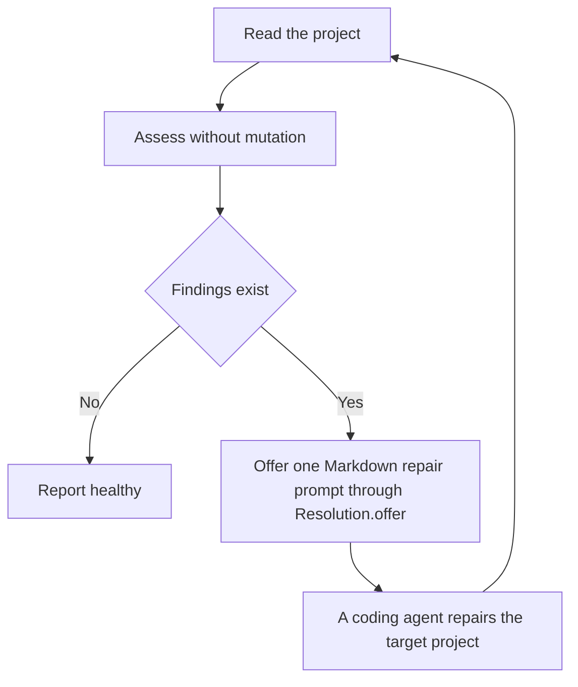

# Architecture

Adamantite is an agent-first preset package and CLI that applies and maintains code-quality
tooling in a target project. Product behavior is documented in the [README](../README.md), and
domain terms live in [GLOSSARY.md](../GLOSSARY.md).

## Runtime

`bin/adamantite` loads `dist/index.js`, which Tsdown bundles from `src/index.ts` with the presets.
The CLI bundle and the Oxlint entry include Effect, so the package installs no Effect.
`src/index.ts` starts the Effect runtime, `src/cli.ts` defines the command tree and the services,
and each module of `src/commands` defines one command. `src/oxlint/index.ts`, the Oxlint entry, and
`src/oxlint/probe.ts`, the probe plugin, run in Oxlint's process. They build beside the CLI bundle
as `dist/oxlint.js` and `dist/probe.js`, which `scripts/test-build.ts` holds.

- A command runs in the target project, the folder that `yield* Project.Directory` gives.
  `eslint/no-restricted-properties` in `oxlint.config.ts` rejects `process.cwd()` and
  `process.chdir()`.
- External behavior, such as the filesystem, prompts, and child commands, is behind Effect services
  that `makeAppLayer` in `src/cli.ts` provides, so a test runs a command without changing a real
  project. `project/file-writers` and `adamantite/import-owners` hold the writes and the prompts.
- The package runs under Node.js and Bun. The tests run under Node.js, and the `test` workflow runs
  the packed CLI and presets with the minimum Bun.

## Layers

The layer maps in `adamantite/layers` in `oxlint.config.ts` are the only statement of the
layers. Each layer has an explicit `imports` list and can contain another map in `layers`.
Imports are transitive within each map. Declaration order does not change permissions. An import
that breaks a map, or a folder that is not in its map, fails `pnpm run check`.

This table lists each layer of the `src` map and of its nested `lib` map, with the layers that it
imports directly. `src/__tests__/architecture-doc.test.ts` fails when the table and the map
disagree.

| Folder                 | Job                                                                                                                                                                                          | Imports              |
| ---------------------- | -------------------------------------------------------------------------------------------------------------------------------------------------------------------------------------------- | -------------------- |
| `src/commands`         | Define the Effect CLI input of each command, decide its output mode, and compose the lib operations.                                                                                         | `terminal`           |
| `src/terminal`         | Print status lines, findings, setup lines, and JSON documents, prompt the user, hand prompts off through `Resolution.offer`, and print the title.                                            | `lib`                |
| `src/lib`              | Hold the library. Lib code returns data, and never prints a line or asks a question.                                                                                                         | None                 |
| `src/lib/setup`        | Apply a selection with `Setup.apply`: install the packages, set the managed scripts, write the managed files under the write rule, and write the lockfile last.                              | `integrations`       |
| `src/lib/assessment`   | Assess the project with each integration that the selection includes, and render the repair prompt and the warning report.                                                                   | `integrations`       |
| `src/lib/bridge`       | Run the check, fix, and analyze stages, route forwarded arguments, and decide the failure policy.                                                                                            | `integrations`       |
| `src/lib/hardening`    | Find the configs, rules folders, instructions, and Markdown files of the project, count the suppressions, find the discovery gaps, run rule trials, and render the harden prompt.            | `integrations`       |
| `src/lib/integrations` | Hold the `Integration` list and one folder for each integration: its packages, its managed files, its `assess`, and its command builder.                                                     | `handoff`, `project` |
| `src/lib/handoff`      | Detect the installed coding agent CLIs, and hand the terminal to one of them.                                                                                                                | `shared`             |
| `src/lib/project`      | Read the target project: `package.json`, the workspace, the lockfile and its selection, the configs through the config loader, and the custom rules. Detect the package manager and install. | `shared`             |
| `src/lib/shared`       | Define errors, filesystem and JSON helpers, the command runner, the working directory, the forwarded arguments, the public imports, and templates.                                           | None                 |

`setup`, `assessment`, `bridge`, and `hardening` are siblings above `integrations`, so none of
them imports another. `assessment` does not import `hardening`, because harden is not an
assessment. `project` and `handoff` are siblings too. `project` knows target-project files and
package state, but not integration types such as `Finding`. Lib code returns data, and commands
render it, so no lib module imports `terminal`.

`cli.ts`, `index.ts`, and the files in `oxlint/` are entries of the `src` map. An entry imports any
layer, and no layer imports an entry. Tests share the helpers in `src/__tests__`, so the `src` map
does not check them. That ignore does not exempt tests from the `lib` map.

The folders inside the layers belong to the layer that holds them:

| Folder                                            | Job                                                                                                                                                                                                  |
| ------------------------------------------------- | ---------------------------------------------------------------------------------------------------------------------------------------------------------------------------------------------------- |
| `src/lib/integrations/agents`                     | The `agents` integration: `AGENTS.md` with the Adamantite section, and each Adamantite skill in each skill folder.                                                                                   |
| `src/lib/integrations/github`                     | The `github` integration: `.github/workflows/adamantite.yml`.                                                                                                                                        |
| `src/lib/integrations/knip`                       | The `knip` integration: `knip.config.ts`, its Knip config schema, and the Knip command builder.                                                                                                      |
| `src/lib/integrations/oxfmt`                      | The `oxfmt` integration: `oxfmt.config.ts`, the plugin languages, and the Oxfmt command builder.                                                                                                     |
| `src/lib/integrations/oxlint`                     | The `oxlint` integration: `oxlint.config.ts`, the preset catalog, the Oxlint runtime, the Oxlint entry, the probe runner, and the command builder. Also the `oxlint-custom` and `tsrs` integrations. |
| `src/lib/integrations/oxlint/plugins`             | The managed plugins: one definition for each, and the registry that the preset catalog derives.                                                                                                      |
| `src/lib/integrations/oxlint/plugins/effect-tsgo` | The `@effect/tsgo` managed plugin and its runtime resolver.                                                                                                                                          |
| `src/lib/integrations/sherif`                     | The `sherif` integration and the Sherif command builder.                                                                                                                                             |
| `src/lib/integrations/tooling`                    | The package checks that several tools share.                                                                                                                                                         |
| `src/lib/integrations/typescript`                 | The `tsconfig` integration: `tsconfig.json`, and the checks that ask TypeScript which files a config loads.                                                                                          |
| `src/lib/integrations/vscode`                     | The `vscode` integration: `.vscode/settings.json` and `.vscode/extensions.json`.                                                                                                                     |
| `src/lib/integrations/zed`                        | The `zed` integration: `.zed/settings.json`.                                                                                                                                                         |
| `src/lib/project/custom-rules`                    | The rules folders, the `custom()` calls that the loaded configs reach, and the rule stubs of `rule add`.                                                                                             |

`adamantite/import-owners` in `oxlint.config.ts` adds two boundaries that the layers cannot state:

- Only `src` and `scripts` import a module of `src`, so no preset and no preset test imports the
  CLI code.
- Only `src/commands`, `src/terminal`, and the tests import `effect/cli/Prompt`, so lib code never
  asks.

`project/file-writers`, the custom rule in `.adamantite/lint/file-writers.ts`, lets only the file
writers that it lists change the disk. In the non-test files of `src`, it rejects a call to a
`FileSystem` method that writes, such as `writeFileString` or `remove`, and an import of
`ensureDirectory` or `writeFile` from `src/lib/shared/filesystem.ts`. It also rejects `node:fs`
outside the build-time macros, so no write bypasses `FileSystem`.

## Integrations

An integration is one folder in `src/lib/integrations` and one line in the list of
`src/lib/integrations/index.ts`. Each one implements `Integration` from
`src/lib/integrations/base.ts`:

- `selected` says whether the selection includes the integration.
- `packages` lists the packages to install at their managed versions.
- `files` renders the managed files whole.
- `prepare`, which only `vscode` has, builds what the integration needs outside the committed
  files, after the install.
- `assess` reads the project and returns its findings, warnings, and package actions.

The list holds `oxlint`, `oxfmt`, `knip`, `sherif`, `tsconfig`, `vscode`, `zed`, `github`, and
`agents`. Three more integrations only assess, and `src/lib/assessment/index.ts` runs them first:
`oxlint-custom` in `src/lib/integrations/oxlint/custom.ts`, the managed plugins in
`src/lib/integrations/oxlint/plugins/managed.ts`, and `tsrs` in
`src/lib/integrations/oxlint/tsrs.ts`.

- An `assess` never writes. `project/file-writers` in `.adamantite/lint/file-writers.ts` rejects a
  write outside the file writers that it lists.
- The logic of one tool stays in its folder, such as `src/lib/integrations/knip/config.ts`. Only
  what several integrations share leaves it: `src/lib/integrations/config-file.ts` for the findings
  of a managed tool config, `src/lib/integrations/tooling/base.ts` for the package checks, and
  `src/lib/integrations/effect-sdk.ts` for the Effect language server of the editors.
  `CODING_STANDARDS.md` states it, and nothing enforces it.
- A command builder is not a member of `Integration`. The `command.ts` of Oxlint, Oxfmt, Knip, and
  Sherif returns `CommandRunOptions` and starts no process, and the bridge and Setup import it.
  Nothing enforces it.

## Setup and the write rule

`init` and `update` share one backend, and differ only in where the selection comes from: the
prompts or the flags for `init`, and the lockfile for `update`. `applySetup` in
`src/commands/setup.ts` runs `Setup.apply` from `src/lib/setup/index.ts`, prints what it did through
`src/terminal/setup.ts`, and offers the repair of the findings that remain.

The write rule: `Setup.apply` writes a managed file only whole, and only when the file does not
exist or its hash equals the hash in the lockfile's `written` map. It never merges or edits a file.
Each file gets a `FileWrite`:

- `Created` when the file did not exist.
- `Replaced` when its hash equaled the recorded hash, so `apply` wrote the current version over it.
- `Unchanged` when it already held the current version.
- `Kept` when the user changed it. Its integration's `assess` reads it and reports only a change
  that breaks the setup.
- `Deleted` when the selection no longer renders it and its hash still matched.

`src/lib/setup/__tests__/index.test.ts` holds the write rule and these invariants:

- `Setup.apply` is the only code that writes the managed files and the lockfile. `project/file-writers`
  in `.adamantite/lint/file-writers.ts` holds it too.
- A second run changes no file. `apply` formats each file with the project's Oxfmt, so
  `adamantite fix` leaves the file as written and its hash still matches.
- A config that Oxfmt cannot load fails `apply` before any write.
- A managed script is the one exception to whole files: `apply` sets each selected script of the
  root `package.json` to its command and overwrites what it held.

## Lockfile

`.adamantite/adamantite-lock.json` records the selection, the Adamantite version that last wrote
it, and the hash of each managed file. `src/lib/project/lockfile.ts` owns its schema, its read, and
the hash. `src/lib/project/selection.ts` owns the `Selection` schema.

- `Project.read` decodes the lockfile one time into `project.lockfile`, and the rest of the code
  trusts that value. Nothing enforces it.
- A lockfile that does not decode, or that a newer Adamantite wrote, fails `init` and `update`
  before they change a file. `src/commands/__tests__/init.test.ts` and
  `src/commands/__tests__/update.test.ts` hold it.
- Only `Setup.apply` writes the lockfile, as its last step. `project/file-writers` in
  `.adamantite/lint/file-writers.ts` holds the writer, and `src/lib/setup/__tests__/index.test.ts`
  holds that a second run changes no file.

`verifyLockfileVersion` compares the lockfile's `version` with the Adamantite that the project
installs. `check` fails with its error after the stages, and `assessProject` reports it as the
`setup-outdated` or `setup-ahead` finding.

## Assessment

An assessment is the read-only check of the target project against the selection in its lockfile.
`Project.read` in `src/lib/project/index.ts` reads the project one time into a `Project.Snapshot`.
`assessProject` in `src/lib/assessment/index.ts` gives that snapshot to the `assess` of each
integration that the selection includes, adds the findings of the managed scripts, and renders the
repair prompt and the warning report.



- `assess` and `doctor` never change the project. A coding agent or the user repairs it, and a later
  assessment confirms the repair. `project/file-writers` in `.adamantite/lint/file-writers.ts`
  rejects a write.
- Each reassessment reads a new snapshot, because a handoff or an install changes the project.
  Nothing enforces it.
- A project without a lockfile, with a lockfile that does not read, or without `adamantite` gets one
  finding alone, so each case goes through the same offer. `src/commands/__tests__/doctor.test.ts`
  holds it.
- Package drift stays structured as package actions, so `update` installs the managed versions and
  Doctor reports them as findings. `src/commands/__tests__/update.test.ts` holds it.

## Resolution and output modes

`Resolution.offer` in `src/terminal/resolution.ts` is the one way that a command hands a prompt to
a coding agent. `doctor`, `init`, and `update` offer the repair prompt of an assessment as a
`Repair`, which fails the command while findings remain. `harden` offers its prompt as a `Task`,
which the user can decline. `CodingAgents` in `src/lib/handoff/coding-agents.ts` detects the
installed agent CLIs and does the handoff.

The command decides its mode once, with `Mode.provide` from `src/terminal/mode.ts`:

- `Json` with `--json`. The offer prints the command's JSON document on standard output, and
  `src/terminal/output.ts` writes every other line on standard error. The command never asks and
  never starts an agent.
- `Menu` when the terminal can prompt and the user allows it. The offer prints the findings, then
  the resolution menu in `src/terminal/resolution-menu.ts`.
- `Plain` otherwise. The offer prints the Markdown prompt, or the warning report when an assessment
  has only warnings.

The tests in `src/commands/__tests__` hold these invariants:

- After an agent session, only the command's `verify` decides success. The offer ignores the exit
  code of the agent.
- An agent CLI that does not start leaves the prompt printed and copied.
- With `--json`, standard output holds only the JSON document, which decodes with the Schema that
  the command exports. `scripts/test-smoke.ts` holds it for the packed CLI.

## Reading configs, comments, and syntax trees

Adamantite takes each fact about the target project from the tool that owns it, and does not parse
source text. Nothing enforces it.

- A tool config comes from the `ConfigLoader` service in `src/lib/project/config-loader.ts`, which
  imports the config with Node.js in a separate process, as Oxlint imports it. Each reader decodes
  the result with a Schema, such as `src/lib/project/lint-config.ts`. Each preset and each
  `custom()` result names itself under the symbol of `presets/identity.ts`, so a preset counts also
  through a spread or a shared config package. `src/lib/project/__tests__/config-loader.test.ts`
  runs the real loader, and the unit tests load in-memory configs with
  `src/__tests__/config-loader.ts`.
- The disable comments and the syntax tree of a file come from Oxlint's parser. The probe plugin,
  `src/oxlint/probe.ts`, reports them, and `src/lib/integrations/oxlint/probe.ts` runs Oxlint with
  only that plugin. `src/lib/hardening/__tests__/suppressions.test.ts` and
  `src/commands/__tests__/rule.test.ts` run it.
- The files that Oxlint lints and its reports come from `src/lib/integrations/oxlint/files.ts`,
  which holds the Oxlint process operations that Doctor, `harden`, and the trials share.

## Command boundaries

Each command is one module of `src/commands`, and `src/cli.ts` lists them.

- `check` checks the formatting with Oxfmt and lints with Oxlint, through `Bridge.check` in
  `src/lib/bridge/index.ts`. It fails on Oxlint warnings unless `--allow-warnings` is set.
- `fix` fixes lint issues, then formats, through `Bridge.fix`.
- `analyze` runs Sherif in a detected monorepo, then Knip, through `Bridge.analyze`.
- `init` reads the selection from its prompts or flags, adds it to the recorded selection, and
  runs `applySetup`.
- `update` runs `applySetup` with the recorded selection. Without a lockfile, it runs no setup and
  offers the `lockfile-missing` finding.
- `doctor` assesses the project, reports the findings, and offers their repair.
- `harden` renders a prompt that tells a coding agent to move the project's coding standards up
  the enforcement ladder, from the facts that `src/lib/hardening/index.ts` computes, and offers it.
  Harden is not an assessment and produces no findings.
- `rule add` writes only a custom rule stub. `rule ast` prints the syntax tree that Oxlint rules
  visit. `rule test` runs the saved tests that a user chose to keep. `rule try` runs a trial in a
  copy of the project, through `src/lib/hardening/trial.ts`.

The tests in `src/commands/__tests__` hold these invariants, and one more test where the line names
it:

- `check`, `fix`, and `analyze` forward the arguments after `--` to one tool. A lifecycle command
  coordinates several operations, so it rejects them. `src/__tests__/cli.test.ts` holds it.
- `check`, `fix`, and `analyze` read the lockfile selection. A missing tool that no selected script
  runs fails with `ToolNotSelected`, which names the `init` command that adds the script.
- Oxlint applies one pass of fixes, so a fix that causes a new fixable report needs a second `fix`.
  `src/lib/bridge/__tests__/index.test.ts` lists each such idiom in `secondPasses`, until Oxlint
  repeats its passes ([oxc#16118](https://github.com/oxc-project/oxc/issues/16118)).
- A trial changes no file of the project. `src/lib/hardening/__tests__/trial.test.ts` holds it.
- `rule try` exits 0 when each case is as expected, 1 when a case is not, and 2 when the trial is
  not evidence.

## Preset layout

```text
presets/
  __tests__/        the stack and fixture tests, and the fixture packages
  identity.ts       the symbol key under which each preset and custom() result names itself
  lint/             published Oxlint presets
    plugins/        first-party Oxlint plugins, one folder for each rule namespace
      entry.ts      the jsPlugins entry of each plugin, for the presets
      shared/       helpers that more than one plugin uses
      adamantite/   the adamantite rules
      quality/        the quality rules of the strict preset
      quality-effect/ the quality-effect rules of the effect preset
      testing/        the testing rules of the strict preset
  rules/            published rules-folder preset, authoring API, loader, and test API
  analyze.ts        published Knip preset
  format.ts         published Oxfmt preset
  tsconfig.json     published TypeScript preset with strict options
  typescript.json   published TypeScript preset with strict options and ts-reset types
  typescript/
    resets/         first-party type resets
```

## Dependency version invariant

An integration records the version of each package that Adamantite installs in target projects,
from the build-time version of the dependency in `package.json`. Packages that belong to Oxlint sit
under `src/lib/integrations/oxlint`: tsrs beside the integration, in
`src/lib/integrations/oxlint/tsrs.ts`, and the managed plugins in
`src/lib/integrations/oxlint/plugins`. The Oxlint integration installs tsrs and the managed plugin
of each selected preset. `getDependencyVersion` in `src/lib/shared/version.macro.ts` fails the build
for a package that `package.json` does not declare.

## Lint presets

`LINT_PRESETS` in `src/lib/project/selection.ts` is the one list of the presets that a target
project can select besides core. `src/lib/integrations/oxlint/presets.ts` gives each one a
definition: its init label and hint, the presets that it requires or excludes, and its managed
plugin.

- Each preset of the list has a definition and a file in `presets/lint`. The type of `definitions`
  and `src/lib/integrations/oxlint/__tests__/presets.test.ts` hold it.
- `package.json` exports core as `adamantite/lint` and each preset as `adamantite/lint/<name>`. It
  has no wildcard export, so the first-party plugins, their rules, and the other modules below
  `presets/lint` stay private, and a new preset needs its own export entry. The same test and
  `src/__tests__/exports.test.ts` hold the export map against `lintPresets` and the README import
  table, and `scripts/test-smoke.ts` rejects each built module that the export map does not list.
- CLI code that writes, resolves, or compares a public import gets it from `publicImport()` in
  `src/lib/shared/package-exports.ts`. Its parameter type is the set of keys in the export map, so
  the type checker rejects a private or removed subpath. Nothing rejects a literal import.

## Managed plugins

A preset can need a third-party Oxlint plugin from npm, such as `@shadcn/lint` for `tailwind`.
`src/lib/integrations/oxlint/plugins` holds one definition for each, the preset catalog links each
plugin to its preset, and `src/lib/integrations/oxlint/plugins/managed.ts` derives one integration
for each. `src/lib/integrations/oxlint/runtime.ts` resolves the Oxlint runtime, with the native
parts that a plugin replaces.

- Each registered plugin package has a managed version. The type of `versions` in
  `src/lib/integrations/oxlint/plugins/managed.ts` holds it.
- No module that the Oxlint entry loads imports a version macro, so the entry runs from source. The
  `presets` tests hold it, because `presets/__tests__/rule-fixtures.ts` starts
  `src/oxlint/index.ts`.
- The resolver reads files, loads no Oxlint module, and changes no process variable. Only a
  process that starts Oxlint applies the `OxlintLaunch` of a runtime: the CLI starts Oxlint's CLI
  module with it, and the Oxlint entry, which editors start, applies it in its own process. Nothing
  enforces it.
- One resolver serves the CLI, the entry, and Doctor, so
  `src/lib/integrations/oxlint/runtime-assessment.ts` reports what the entry would find.
  `src/lib/integrations/oxlint/__tests__/runtime.test.ts` and
  `src/lib/integrations/oxlint/__tests__/runtime-assessment.test.ts` hold the resolver.
- Only the Effect plugin replaces native parts, so no two overrides replace one part. Nothing
  enforces it.

## Type resets

`adamantite/typescript` loads the type resets in `presets/typescript/resets`, through
`presets/typescript/resets/index.d.ts`. `src/lib/integrations/typescript/index.ts` asks the
project's TypeScript which configs load them, so Doctor reports a library that does.

- Each reset has a fixture of type tests in `src/__tests__/presets/fixtures/typescript` that passes
  with `adamantite/typescript` and fails with `adamantite/tsconfig`, and `index.d.ts` references
  each reset. `presets/__tests__/typescript.test.ts` holds it.
- The build ships each file that the built preset loads. `scripts/test-build.ts` holds it.

## First-party plugins

Adamantite has four Oxlint plugins of its own in `presets/lint/plugins`: `adamantite`, `quality`
and `testing`, which ship in the `strict` preset, and `quality-effect`, which ships in the `effect`
preset. A
preset gets the `jsPlugins` entry of a plugin from `firstPartyPlugin` in
`presets/lint/plugins/entry.ts`. The `architecture` preset loads the `adamantite` plugin without
enabling rules, because `adamantite/layers` and `adamantite/import-owners` need options from the
target project.

- The folder name of a plugin is its rule namespace and its `meta.name`.
  `presets/lint/plugins/__tests__/entry.test.ts` holds it.
- Rule code runs under the runtime that executes Oxlint in the target project, so it uses only
  runtime-neutral APIs. It imports only types from `@oxlint/plugins`, and its one runtime package
  is `oxc-resolver`, in `presets/lint/plugins/adamantite/shared/resolver.ts`. The preset build in
  `tsdown.config.ts` fails when it bundles another package, and `scripts/test-smoke.ts` installs
  the package without `@oxlint/plugins`. Nothing rejects an API that only one runtime has.
- `presets/lint/plugins/tsconfig.json` lets the source import rule modules with their `.ts`
  extension, which Node.js needs to load a plugin from source. The `presets` tests hold it.
- Each rule has a RuleTester test, and `valid` and `invalid` fixtures that a real Oxlint run lints
  through the Oxlint entry. [Place a test](../CONTRIBUTING.md#place-a-test) names the folders, and
  `presets/__tests__/rule-fixtures.ts` is the harness.
- A valid fixture is code that a target project can keep: no rule of a stack reports it, and each
  invalid fixture still gets the report of its rule. `presets/__tests__/stacks.test.ts` holds it,
  and lists each report that stays in `knownReports`.
- No two presets set one rule, unless one of them is core, and each core rule that a preset changes
  has a fixture that gets a different result from core alone. `presets/__tests__/overlap.test.ts`
  holds it.
- The fixture packages in `presets/__tests__/fixture-packages` are a separate pnpm workspace, and no
  package is in both manifests. `presets/__tests__/fixture-packages.test.ts` holds it.
- The fixtures of `adamantite/layers` and `adamantite/import-owners` are small projects, which
  `presets/__tests__/model-fixtures.ts` lints for `presets/__tests__/layers.test.ts` and
  `presets/__tests__/import-owners.test.ts`.
- A rule declares the hand-written config that it replaces in `meta.docs.replaces`, and
  `src/lib/integrations/oxlint/replacements.ts` reads every declaration, so Doctor names no rule.
  `src/lib/integrations/oxlint/__tests__/replacements.test.ts` holds it.
- Each `license.md` below `presets` ships at the same path in `dist/presets`.
  `scripts/test-build.ts` holds it.

## Custom rules

Custom rules are Oxlint rules that the target project writes in a rules folder, by default
`.adamantite/lint`.

- `presets/rules` is the published side: `custom()` in `presets/rules/custom.ts`, the loader in
  `presets/rules/load.ts`, the authoring API in `presets/rules/plugin.ts`, the test API in
  `presets/rules/testing.ts`, and what a rules folder holds in `presets/rules/folder.ts`.
- `src/lib/project/custom-rules` is the CLI side: the discovery of the `custom()` calls that the
  loaded configs reach, the stub of `rule add`, and the saved tests of `rule test`.
- `src/lib/integrations/oxlint/custom.ts` is the `oxlint-custom` integration, which reports the
  rules folders that no config loads.
- The "Custom rules" section of `skills/adamantite-hardening/SKILL.md` links to the authoring
  guidance in `skills/adamantite-hardening/references/custom-rules.md`, which tells an agent how to
  verify a rule with
  temporary RuleTester cases.

These invariants hold:

- `custom()` and the loader run under the runtime that executes Oxlint, so they use only the
  Node.js APIs that Bun also provides. `presets/__tests__/custom.test.ts` lints projects that call
  `custom()` in real Oxlint runs under Node.js, and the `test` workflow runs `custom()` with the
  minimum Bun.
- A project type-checks its rules without `@oxlint/plugins`, because the build inlines the
  authoring types into the published declarations. `scripts/test-smoke.ts` holds it.
- `presets/lint/tsconfig.json` and `presets/rules/tsconfig.json` extend the root config, so
  type-aware lint sees the Node.js types and the `.ts` import extensions. `pnpm run check` holds
  it.
- Adamantite keeps no temporary verification case in the target project, and only
  `adamantite rule test` runs a saved test. Nothing enforces the first part, which the skill asks
  of the agent.
